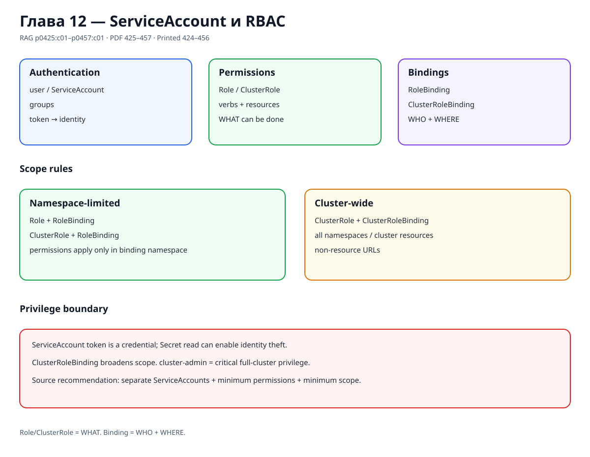
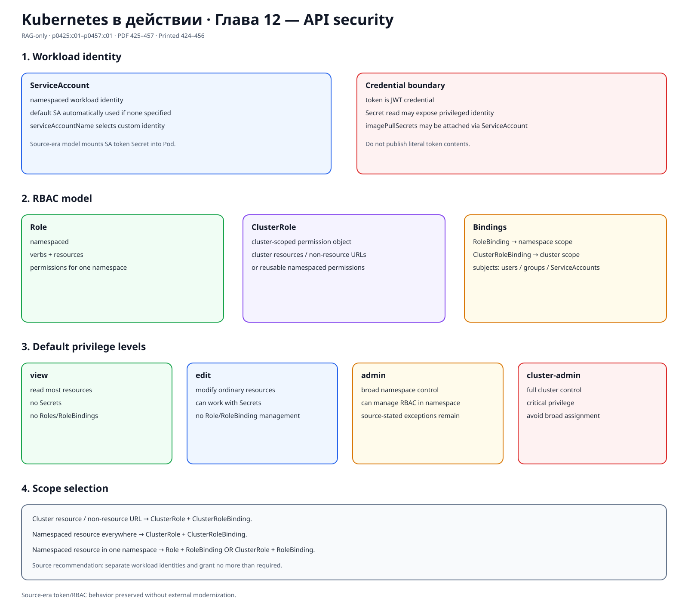

# Глава 12 — Защита сервера API Kubernetes

Практические и концептуальные заметки по главе 12 книги «Kubernetes в действии» Марко Лукши.

## Идентификация

- Book ID: kubernetes-in-action-marko-luksa-ru
- Глава: 12
- Slug: securing-the-kubernetes-api-server
- Source policy: rag_only
- External sources: запрещены
- Model memory: запрещена
- Прямой доступ к canonical PDF: не использовался

## Provenance

- RAG chunks: p0425:c01–p0457:c01
- PDF pages: 425–457
- Printed pages: 424–456
- p0425:c01 начинается заголовком главы 12.
- p0457:c01 содержит явный раздел 12.3 Резюме.
- p0458:c01 начинает главу 13.
- Chapter boundary verified: yes
- Source SHA-256: 0d50f167ed86088d0cc65d15e27f1ab397e7c0a0c8de4db3801b50439f24266f

## Содержимое

- [cheatsheet.md](cheatsheet.md) — authentication, ServiceAccount и RBAC scope matrix.
- [commands.md](commands.md) — source-confirmed команды с privilege classification.
- [diagram.md](diagram.md) — Mermaid-схемы identity/authorization/RBAC scope.
- [summary.md](summary.md) — RAG-grounded резюме раздела 12.3.
- [review-questions.md](review-questions.md) — один крупный explicit RBAC exercise.
- [review-answers.md](review-answers.md) — RAG-grounded procedure; не официальный answer key.
- [visual-cheatsheet.svg](visual-cheatsheet.svg)
- [visual-cheatsheet-detailed.svg](visual-cheatsheet-detailed.svg)

## Карта главы

1. Authentication plugins определяют identity клиента.
2. Users и ServiceAccounts могут входить в groups.
3. ServiceAccount — namespaced Kubernetes resource.
4. Pod связан ровно с одной ServiceAccount из того же namespace.
5. Если serviceAccountName не задан, используется default ServiceAccount namespace.
6. ServiceAccount token в source-era model автоматически создаётся как Secret и монтируется в Pod.
7. Custom ServiceAccount позволяет разделять permissions между workloads.
8. ServiceAccount может ограничивать mountable Secrets через source-era annotation.
9. imagePullSecrets могут быть указаны на ServiceAccount и автоматически добавляться Pods.
10. serviceAccountName задаётся при создании Pod и source говорит, что позже изменить его нельзя.
11. Authentication не равна authorization.
12. RBAC определяет, какие verbs субъект может выполнять над какими resources.
13. Role и RoleBinding — namespaced resources.
14. ClusterRole и ClusterRoleBinding — cluster-scoped resources.
15. RoleBinding может ссылаться как на Role, так и на ClusterRole.
16. RoleBinding ограничивает действие namespace своей привязки.
17. ClusterRoleBinding применяет ClusterRole cluster-wide.
18. Для cluster-scoped resources требуется ClusterRole + ClusterRoleBinding.
19. Для namespaced resources across all namespaces — ClusterRole + ClusterRoleBinding.
20. Для namespaced resources в одном namespace — Role + RoleBinding либо ClusterRole + RoleBinding.
21. Source default ClusterRoles: view, edit, admin, cluster-admin.
22. view не даёт читать Secrets/RBAC resources, чтобы снижать privilege-escalation risk.
23. edit позволяет менять обычные namespaced resources и Secrets, но не Roles/RoleBindings.
24. admin даёт контроль над namespaced resources включая Roles/RoleBindings, с source-stated exceptions.
25. cluster-admin — полный контроль и высокий privilege boundary.
26. Source рекомендует least privilege и отдельные ServiceAccounts для разных workloads.

## Краткий анализ главы

Глава связывает identity и authorization в единый security model API server.

Authentication определяет, кто делает запрос. Source перечисляет users, ServiceAccounts и groups. ServiceAccount — workload identity: Pod получает ServiceAccount token и использует его для API authentication. Затем authorization plugin решает, что этому identity разрешено делать.

Custom ServiceAccounts нужны не ради отдельного имени, а ради разделения permissions. Workload, которому нужен только read access, не должен получать mutation permissions. Source прямо подводит к принципу least privilege.

В source-era модели ServiceAccount имеет token Secret. Этот Secret содержит CA, namespace и JWT token. Это credential material: его чтение эквивалентно получению API identity. Поэтому artifacts не воспроизводят literal JWT values.

RBAC строится из двух разных сущностей: role определяет permissions, binding определяет subjects. Role/RoleBinding ограничены namespace. ClusterRole/ClusterRoleBinding существуют на уровне cluster.

Ключевая тонкость — ClusterRole сама по себе не означает cluster-wide scope. Scope определяется binding:
- ClusterRole + ClusterRoleBinding → cluster-wide;
- ClusterRole + RoleBinding → только namespace RoleBinding.

Это позволяет создать reusable ClusterRole и привязать её локально в нескольких namespaces.

Cluster-scoped resources, например PersistentVolume, нельзя разрешить через RoleBinding, даже если она ссылается на ClusterRole. Source lab демонстрирует failure такого подхода, затем заменяет RoleBinding на ClusterRoleBinding.

Default roles source описывает как уровни privilege. view специально исключает Secrets и RBAC resources, чтобы read-only субъект не получил token более привилегированной identity. edit позволяет работать с Secrets, но не с Roles/RoleBindings. admin включает RBAC management within namespace. cluster-admin — полный контроль.

Source отдельно отмечает anti-escalation rule: API server позволяет пользователю создавать или изменять Role только если пользователь уже обладает всеми permissions, перечисленными в этой Role, в соответствующем scope.

Финальная рекомендация главы — не расширять default ServiceAccount до объединения всех permissions workload'ов. Лучше отдельная ServiceAccount на workload/replica set и минимальная Role/ClusterRole, привязанная в минимально необходимом scope.

## Основной принцип

~~~text
request
  ↓
authentication
  ↓ identity: user / ServiceAccount / groups
  ↓
authorization (RBAC)
  ↓
Role or ClusterRole = WHAT
RoleBinding or ClusterRoleBinding = WHO + WHERE
~~~

## Security boundaries

- ServiceAccount token — credential.
- Secret read access может привести к privilege escalation.
- ClusterRoleBinding расширяет действие permissions на cluster scope.
- cluster-admin — critical privilege.
- Source GKE command, выдающий пользователю cluster-admin, рассматривается только как lab/admin escalation example.
- Принцип главы: minimum permissions, minimum scope.

## Ограничения

- Source-era token Secret model, API versions и commands сохраняются без modernization.
- Современный ServiceAccount token behavior не проверялся извне.
- Literal JWT token из source не переносится.
- Source-era annotation enforce-mountable-secrets сохраняется как source behavior.
- Команды RBAC lab могут изменять реальный cluster authorization state и должны выполняться только в disposable/controlled lab.
