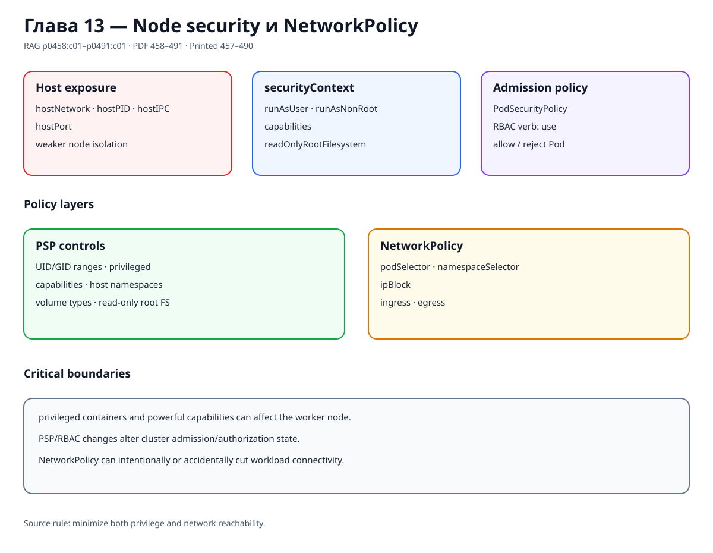
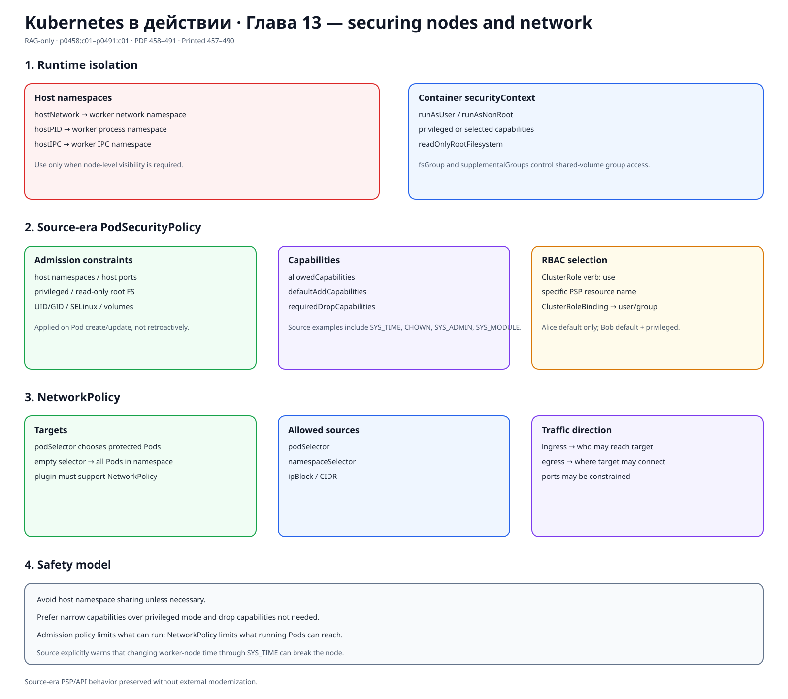

# Глава 13 — Защита узлов кластера и сети

Практические и концептуальные заметки по главе 13 книги «Kubernetes в действии» Марко Лукши.

## Идентификация

- Book ID: kubernetes-in-action-marko-luksa-ru
- Глава: 13
- Slug: securing-cluster-nodes-and-network
- Source policy: rag_only
- External sources: запрещены
- Model memory: запрещена
- Прямой доступ к canonical PDF: не использовался

## Provenance

- RAG chunks: p0458:c01–p0491:c01
- PDF pages: 458–491
- Printed pages: 457–490
- p0458:c01 начинается заголовком главы 13.
- p0491:c01 содержит явный раздел 13.5 Резюме.
- p0492:c01 начинает главу 14.
- Chapter boundary verified: yes
- Source SHA-256: 0d50f167ed86088d0cc65d15e27f1ab397e7c0a0c8de4db3801b50439f24266f

## Содержимое

- cheatsheet.md — host namespaces, securityContext, capabilities, PodSecurityPolicy и NetworkPolicy.
- commands.md — source-confirmed команды с risk classification.
- diagram.md — Mermaid-схемы node isolation, PSP admission и network isolation.
- summary.md — RAG-grounded резюме раздела 13.5.
- review-questions.md — один явно обозначенный PSP/RBAC exercise.
- review-answers.md — RAG-grounded walkthrough; не официальный answer key.
- visual-cheatsheet.svg
- visual-cheatsheet-detailed.svg

## Карта главы

1. По умолчанию Pod получает собственные Linux namespaces.
2. hostNetwork подключает Pod к network namespace worker node.
3. hostPort публикует container port на конкретном node без полного hostNetwork.
4. hostPID и hostIPC дают доступ к PID/IPC namespaces node.
5. securityContext.runAsUser задаёт UID процесса container.
6. runAsNonRoot запрещает запуск root process.
7. privileged: true даёт container расширенный доступ к node/kernel devices.
8. Linux capabilities позволяют выдавать/забирать отдельные kernel privileges.
9. CAP_SYS_TIME source показывает как пример capability с реальным node-wide side effect.
10. capabilities.drop используется для удаления capabilities.
11. readOnlyRootFilesystem запрещает запись в container root filesystem, но mounted volumes остаются writable согласно их mode.
12. fsGroup задаёт filesystem group для volumes.
13. supplementalGroups добавляет process supplementary groups.
14. PodSecurityPolicy — source-era cluster-scoped admission policy.
15. PSP может ограничивать host namespaces, host ports, privileged mode, UID/GID ranges, capabilities, SELinux labels, root filesystem mode и volume types.
16. PSP применяется при create/update Pod, а не ретроактивно к существующим Pods.
17. MustRunAs может переопределять UID container относительно image USER.
18. MustRunAsNonRoot запрещает root.
19. allowedCapabilities/defaultAddCapabilities/requiredDropCapabilities управляют capability policy.
20. PSP policies назначаются users/groups через RBAC verb use.
21. Source exercise разделяет Alice и Bob: Alice получает only default PSP, Bob — additionally privileged PSP.
22. NetworkPolicy ограничивает ingress/egress выбранных Pods.
23. Empty podSelector в source default-deny policy выбирает все Pods namespace.
24. podSelector позволяет разрешить traffic между определёнными workloads.
25. namespaceSelector ограничивает source namespaces.
26. ipBlock задаёт разрешённый CIDR.
27. egress rules ограничивают исходящий traffic выбранных Pods.
28. NetworkPolicy требует network implementation/plugin с поддержкой policy.

## Краткий анализ главы

Глава смещает security boundary с API permissions на node/runtime isolation.

Первая часть показывает, что container isolation может быть ослаблена намеренно. hostNetwork, hostPID и hostIPC подключают Pod к namespaces node. hostPort связывает конкретный port Pod с port worker node. Это не просто networking convenience: такой Pod получает больше visibility и tighter coupling с node.

securityContext позволяет управлять process identity и privileges. runAsUser меняет UID container; runAsNonRoot запрещает root execution. privileged mode представляет противоположный край — container получает доступ к node devices и широким kernel operations.

Linux capabilities дают более точный механизм, чем privileged mode. Source демонстрирует SYS_TIME: без capability попытка изменить system time fails, а с capability — succeeds и меняет время node. Source прямо предупреждает, что такой эксперимент способен сделать worker node неработоспособным.

readOnlyRootFilesystem уменьшает write surface container. Однако application всё ещё может писать в explicitly mounted volumes. fsGroup и supplementalGroups позволяют двум containers с разными UID совместно использовать volume через общую filesystem group.

PodSecurityPolicy переносит ограничения из individual Pod spec в admission policy cluster level. Source-era PSP проверяет Pod definitions при create/update и может запретить host namespaces, privileged containers, unsafe capabilities, invalid UID/GID ranges или undesired volume types. Existing Pods при смене policy не изменяются.

Особенно важен RBAC link. Несколько PSP могут coexist, а admission рассматривает policies, которые user имеет право use. Source exercise создаёт default и privileged policies, ClusterRoles с verb use и ClusterRoleBindings: system:authenticated получает default, Bob additionally получает privileged. Результат: Alice не может создать privileged Pod, Bob может.

NetworkPolicy завершает chapter network isolation. Policy выбирает target Pods через podSelector и ограничивает ingress/egress по Pod labels, namespace labels или CIDR. Source подчёркивает, что policy действует только если используемое networking solution её поддерживает.

## Основной принцип

Minimize both privilege and reachability:
- не подключать Pod к host namespaces без необходимости;
- не использовать privileged container, если достаточно отдельных capabilities;
- удалять ненужные capabilities;
- использовать read-only root filesystem, где возможно;
- ограничивать admissible Pod security settings policy;
- ограничивать network paths NetworkPolicy.

## Critical safety boundaries

- hostNetwork/hostPID/hostIPC weaken node isolation.
- privileged: true is a major privilege boundary.
- SYS_TIME can alter worker-node system time.
- PSP/RBAC changes alter cluster admission/authorization policy.
- ClusterRoleBinding in PSP exercise has cluster-wide authorization scope.
- Source lab credentials are not copied into artifacts.
- NetworkPolicy changes can intentionally or accidentally cut workload connectivity.

## Ограничения

- PodSecurityPolicy, API versions and Minikube flags are preserved as source-era concepts without external modernization.
- Modern replacement mechanisms are not introduced.
- Source credentials are not copied.
- NetworkPolicy behavior is described only at the level supported by chapter source.
- No unverified troubleshooting commands are added.
