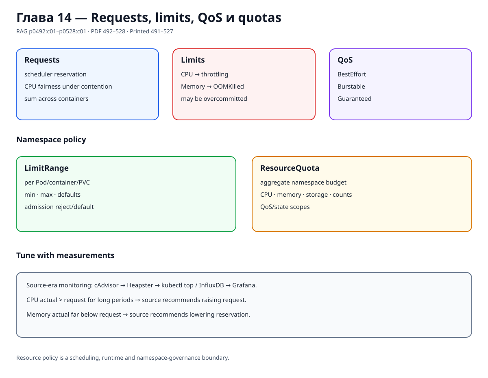
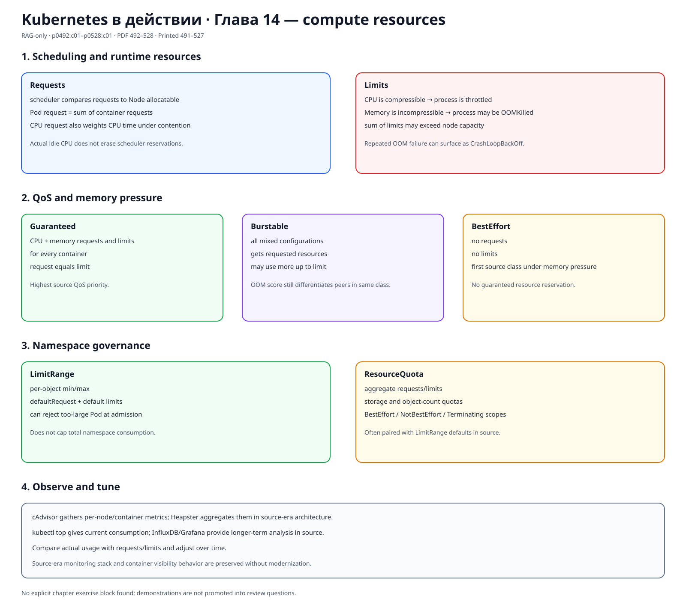

# Глава 14 — Управление вычислительными ресурсами модулей

Практические и концептуальные заметки по главе 14 книги «Kubernetes в действии» Марко Лукши.

## Идентификация

- Book ID: kubernetes-in-action-marko-luksa-ru
- Глава: 14
- Slug: managing-compute-resources
- Source policy: rag_only
- External sources: запрещены
- Model memory: запрещена
- Прямой доступ к canonical PDF: не использовался

## Provenance

- RAG chunks: p0492:c01–p0528:c01
- PDF pages: 492–528
- Printed pages: 491–527
- p0492:c01 начинается заголовком главы 14.
- p0527:c01–p0528:c01 содержат явный раздел 14.7 Резюме.
- p0529:c01 начинает главу 15.
- Chapter boundary verified: yes
- Source SHA-256: 0d50f167ed86088d0cc65d15e27f1ab397e7c0a0c8de4db3801b50439f24266f

## Содержимое

- [cheatsheet.md](cheatsheet.md) — requests, limits, QoS, LimitRange, ResourceQuota и monitoring.
- [commands.md](commands.md) — source-confirmed команды с operational classification.
- [diagram.md](diagram.md) — Mermaid-схемы scheduling, QoS, quota и monitoring.
- [summary.md](summary.md) — RAG-grounded резюме раздела 14.7.
- [visual-cheatsheet.svg](visual-cheatsheet.svg)
- [visual-cheatsheet-detailed.svg](visual-cheatsheet-detailed.svg)

## Conditional artifacts

- review-questions.md: не создан — в проверенной границе нет отдельного явно обозначенного exercise block.
- review-answers.md: не создан по той же причине.
- Формулировка «можете попробовать» в p0514 рассматривается как demonstration, а не как самостоятельное review exercise.

## Карта главы

1. Resource requests задаются на уровне container.
2. Pod requests являются суммой requests всех containers.
3. Scheduler сопоставляет requests с Node allocatable, а не с фактическим текущим потреблением.
4. Capacity и allocatable — разные величины.
5. Pod остаётся Pending, если ни один node не может удовлетворить requests.
6. CPU requests участвуют в распределении CPU time при contention.
7. Неиспользуемый CPU может использоваться сверх request, если нет конкуренции.
8. Extended Resources source-era model позволяет добавлять custom integer resources в Node capacity.
9. Resource limits задают верхнюю границу потребления container.
10. CPU — compressible resource: превышение CPU limit ведёт к throttling, а не к kill.
11. Memory — incompressible resource: превышение memory limit может привести к OOMKilled.
12. CrashLoopBackOff source объясняет increasing restart delay after repeated failures.
13. Sum of limits may exceed node capacity; limits may be overcommitted.
14. Source-era applications may see host-level CPU/memory rather than container limits through ordinary tools such as top.
15. QoS class derived from requests/limits, not set directly.
16. BestEffort: no requests and no limits.
17. Guaranteed: CPU and memory requests/limits set for every container and request equals limit.
18. Burstable: all remaining combinations.
19. Under node memory pressure source orders eviction/kill preference BestEffort → Burstable → Guaranteed.
20. Within same QoS class OOM score and actual memory relative to request affect selection.
21. LimitRange sets per-object/container minimums, maximums and defaults in a namespace.
22. LimitRange can reject a Pod whose request exceeds configured maximum.
23. LimitRange defaults can inject requests/limits into containers that omitted them.
24. ResourceQuota limits aggregate namespace consumption.
25. ResourceQuota can limit aggregate CPU/memory requests and limits.
26. ResourceQuota can limit requested persistent storage, including per StorageClass.
27. ResourceQuota can limit counts of selected API objects.
28. ResourceQuota scopes in source: BestEffort, NotBestEffort, Terminating, NotTerminating.
29. When quota requires resource requests/limits, Pods omitting them are rejected unless defaults supply them.
30. cAdvisor in Kubelet collects usage metrics in source-era architecture.
31. Heapster aggregates metrics in source-era architecture.
32. kubectl top exposes current usage.
33. InfluxDB/Grafana source examples retain longer history and visualization.
34. Actual consumption over time should be used to tune requests/limits.

## Краткий анализ главы

Глава разделяет resource configuration на две разные задачи: планирование capacity и ограничение runtime consumption.

Requests прежде всего являются входом scheduler. Scheduler смотрит на allocatable resources node и сумму уже зарезервированных requests. Фактическое текущее потребление CPU/memory не освобождает scheduler от этой модели. Поэтому Pod может оставаться Pending даже когда node выглядит почти idle: формально свободного allocatable после учёта requests недостаточно.

CPU request дополнительно влияет на runtime fairness. Когда containers конкурируют за CPU, source распределяет CPU time пропорционально requests. Если конкуренции нет, container может использовать больше requested CPU при отсутствии limiting boundary.

Limits решают другую задачу. CPU limit регулирует процессорное время: source рассматривает CPU как compressible resource. Memory limit принципиально жёстче: память нельзя «отобрать» у процесса так же, как CPU time, поэтому процесс, выходящий за memory limit, может быть уничтожен и получить status OOMKilled.

Глава отдельно показывает, что limits могут быть overcommitted: сумма limits Pods на node может превышать capacity. Это означает, что при одновременном фактическом потреблении выше available memory Kubernetes/Linux должен выбрать процессы для убийства.

QoS — derived classification. BestEffort не имеет requests/limits; Guaranteed требует равенства requests и limits для CPU и memory каждого container; остальные Pods становятся Burstable. При memory pressure эта classification влияет на приоритет уничтожения, но внутри одного класса учитывается ещё и OOM score, связанный с memory usage и request.

LimitRange и ResourceQuota действуют на разных уровнях:
- LimitRange — per Pod/container/PVC constraints/defaults;
- ResourceQuota — aggregate namespace budget.

LimitRange может не только reject invalid requests, но и source-era admission defaulting добавляет requests/limits в Pod, если они не указаны. Это удобно вместе с ResourceQuota: если quota требует explicit requests/limits, defaults позволяют Pod пройти quota admission без явного задания каждого поля пользователем.

ResourceQuota может ограничивать CPU/memory, storage, число объектов и source-era QoS/state scopes. Это namespace-level governance, а не per-Pod cap.

Последний раздел связывает configuration с observability. Source-era cAdvisor → Heapster → kubectl top предоставляет текущие metrics, а InfluxDB/Grafana — историческую картину. Главный operational вывод: requests/limits нельзя один раз угадать и забыть; их нужно корректировать по реальному потреблению за достаточно длинный период.

## Основной принцип

~~~text
requests
  → scheduler reservation
  → CPU fairness

limits
  → maximum runtime consumption
  → CPU throttling / memory OOM boundary

LimitRange
  → per-object policy/defaults

ResourceQuota
  → namespace aggregate budget

metrics over time
  → tune requests and limits
~~~

## Operational boundaries

- Слишком высокие requests → underutilization и unschedulable capacity.
- Слишком низкие CPU requests → workload может терять CPU time under contention.
- Слишком низкий memory limit → OOMKilled / restart loop.
- ResourceQuota/LimitRange меняют admission behavior namespace и могут блокировать новые workloads.
- Source requests cleanup of quota/LimitRange before later examples; exact broad cleanup command is not reconstructed.
- Source-era Heapster/InfluxDB/Grafana behavior preserved without external modernization.

## Ограничения

- Kubernetes versions, Heapster architecture, kubectl run syntax and container-limit visibility are preserved exactly at source-era level.
- Modern metrics-server behavior is not substituted for Heapster.
- Exact broad delete command for all ResourceQuota/LimitRange objects is [Needs confirmation].
- No external documentation was used to modernize QoS or quota semantics.
