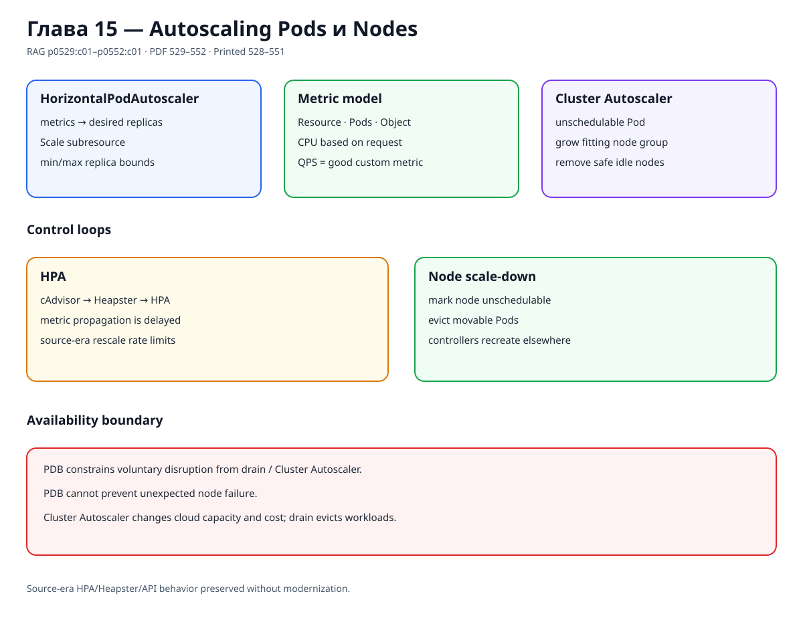
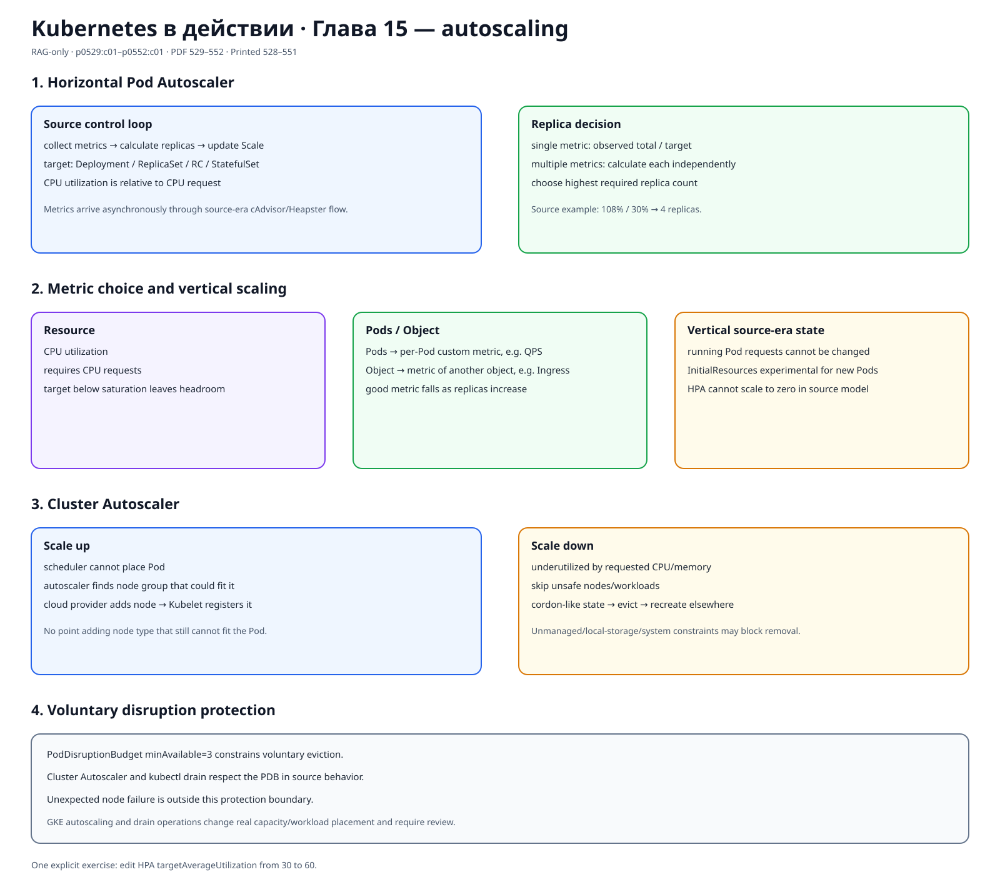

# Глава 15 — Автоматическое масштабирование модулей и узлов кластера

Практические и концептуальные заметки по главе 15 книги «Kubernetes в действии» Марко Лукши.

## Идентификация

- Book ID: kubernetes-in-action-marko-luksa-ru
- Глава: 15
- Slug: autoscaling-pods-and-cluster-nodes
- Source policy: rag_only
- External sources: запрещены
- Model memory: запрещена
- Прямой доступ к canonical PDF: не использовался

## Provenance

- RAG chunks: p0529:c01–p0552:c01
- PDF pages: 529–552
- Printed pages: 528–551
- p0529:c01 начинается заголовком главы 15.
- p0551:c01–p0552:c01 содержат явный раздел 15.4 Резюме.
- p0553:c01 начинает главу 16.
- Chapter boundary verified: yes
- Source SHA-256: 0d50f167ed86088d0cc65d15e27f1ab397e7c0a0c8de4db3801b50439f24266f

## Содержимое

- [cheatsheet.md](cheatsheet.md) — HPA, metric types, vertical autoscaling, Cluster Autoscaler и PDB.
- [commands.md](commands.md) — source-confirmed команды с operational classification.
- [diagram.md](diagram.md) — Mermaid-схемы metric flow, HPA decisions, node autoscaling и PDB.
- [summary.md](summary.md) — RAG-grounded резюме раздела 15.4.
- [review-questions.md](review-questions.md) — один явно обозначенный HPA exercise.
- [review-answers.md](review-answers.md) — RAG-grounded walkthrough; не официальный answer key.
- [visual-cheatsheet.svg](visual-cheatsheet.svg)
- [visual-cheatsheet-detailed.svg](visual-cheatsheet-detailed.svg)

## Карта главы

1. HorizontalPodAutoscaler автоматически изменяет число replicas целевого workload.
2. Source target resources: Deployment, ReplicaSet, ReplicationController, StatefulSet.
3. HPA process: получить metrics → вычислить desired replicas → обновить Scale subresource.
4. Source-era metric flow: container → cAdvisor → Heapster → HPA controller.
5. Metrics распространяются периодически, поэтому scaling имеет задержку.
6. CPU utilization HPA вычисляется относительно CPU request, а не node capacity или CPU limit.
7. Для CPU-based HPA у Pods должны быть CPU requests.
8. Source recommendation: target CPU заметно ниже 100%, чтобы оставлять headroom.
9. kubectl autoscale source создаёт HPA с min/max replicas и target CPU.
10. Source советует масштабировать Deployment, а не underlying ReplicaSet.
11. HPA может временно показывать metric target как unknown, пока metrics не появились.
12. Low utilization заставляет HPA scale down до minReplicas.
13. Load generator повышает CPU usage и вызывает scale up.
14. CPU utilization может быть выше 100%, потому что request — minimum guarantee, а не maximum.
15. Simplified replica calculation: total observed metric / target, rounded.
16. При нескольких metrics HPA source выбирает максимальное required replica count.
17. HPA изменяет target через Scale subresource.
18. Source ограничивает скорость scale-up и частоту rescale operations.
19. HPA target можно изменить через kubectl edit.
20. Удаление HPA source прекращает autoscaling, но не возвращает target к предыдущему replica count.
21. Memory-based HPA source считает проблематичным, потому что scale-out сам по себе не освобождает уже занятую память.
22. Source говорит, что memory-based autoscaling появилось в Kubernetes 1.8.
23. Source metric types: Resource, Pods, Object.
24. Pods metric подходит для per-Pod custom metrics, например QPS.
25. Object metric подходит для metric другого API object, например Ingress latency.
26. Хорошая autoscaling metric должна снижаться примерно обратно пропорционально росту replica count.
27. QPS source приводит как подходящий пример.
28. Source-era HPA не позволяет minReplicas: 0.
29. Source-era vertical autoscaling existing Pod недоступно.
30. Experimental InitialResources admission plugin source мог задавать requests новым Pods по historical usage.
31. Cluster Autoscaler добавляет node при unschedulable Pod, если подходящий node type может его разместить.
32. Cluster Autoscaler работает с node groups/pools.
33. Source-era scale-down considers node requested CPU/memory and additional safety constraints.
34. Node с system-only workload, unmanaged Pod или local storage source может блокировать scale-down.
35. Before removal node is made unschedulable and managed Pods are evicted/recreated elsewhere.
36. cordon marks node unschedulable.
37. drain marks node unschedulable and evicts Pods.
38. uncordon restores scheduling.
39. Source GKE command enables cluster autoscaling with min/max nodes.
40. Cluster Autoscaler status source публикует в ConfigMap cluster-autoscaler-status.
41. PodDisruptionBudget protects minimum availability during voluntary disruption.
42. Source PDB uses minAvailable; source note also mentions maxUnavailable from Kubernetes 1.7.
43. PDB is respected by source Cluster Autoscaler and kubectl drain.
44. PDB cannot prevent unexpected node failure.

## Краткий анализ главы

Глава связывает два уровня elasticity: количество Pods и количество nodes.

HorizontalPodAutoscaler не запускает Pods напрямую. Он наблюдает metrics, вычисляет необходимое число replicas и меняет Scale subresource целевого объекта. Затем обычные controllers Deployment/ReplicaSet/StatefulSet доводят actual state до нового desired replica count.

Source-era metric pipeline асинхронен: cAdvisor собирает metrics на node, Heapster агрегирует их, HPA controller периодически получает данные. Поэтому reaction time не мгновенный. Это важно при интерпретации apparent delay между load spike и scale event.

CPU utilization для HPA нормируется относительно CPU request. Если container request = 100m, а фактическое потребление = 108m, HPA увидит 108%, что допустимо: request не является hard cap. Поэтому CPU requests — обязательная часть source HPA example.

В source example target = 30%, initial one Pod reaches 108%, HPA рассчитывает примерно 108/30 = 3.6 и scales to 4. Это иллюстрирует основную идею: replica count меняется так, чтобы средняя metric приблизилась к target.

При нескольких metrics source вычисляет required replicas для каждой отдельно и выбирает наибольшее значение. Такой алгоритм защищает от under-scaling, если одна из metrics требует больше capacity.

Не всякая metric годится для autoscaling. Source требует, чтобы увеличение replicas приводило к примерно пропорциональному снижению metric per replica. QPS подходит; memory usage часто не подходит, потому что добавление новых Pods не заставляет старые Pods автоматически освобождать уже занятую память.

Vertical autoscaling в source-era Kubernetes описано как ещё недоступное для running Pods. Experimental InitialResources может задавать requests новым Pods из historical observations, но source не показывает production-ready VPA workflow.

Cluster Autoscaler решает другой класс проблемы: HPA может захотеть больше Pods, но scheduler не сможет разместить их. Тогда Cluster Autoscaler наблюдает unschedulable Pods и увеличивает подходящую node group. Scale-down выполняется только когда node считается безопасным для удаления: workloads должны быть переносимы, а eviction не должен нарушать service constraints.

PodDisruptionBudget вводит availability constraint для добровольных disruptions. В source example minAvailable=3 не позволяет Cluster Autoscaler или kubectl drain уменьшить available replicas ниже трёх. Это protection against voluntary eviction, а не against hardware/network failure.

## Основной принцип

~~~text
workload metrics
  ↓
HPA
  ↓ Scale subresource
desired replicas
  ↓
workload controller
  ↓
Pods

if Pods cannot schedule
  ↓
Cluster Autoscaler
  ↓
node group grows

when nodes shrink
  ↓
PDB limits voluntary disruption
~~~

## Operational boundaries

- HPA changes replica count continuously; manual scaling may be overwritten by HPA.
- Changing HPA target changes production scaling behavior.
- Load generator intentionally creates sustained traffic/CPU load.
- Cluster Autoscaler can create/delete cloud instances and change cost/capacity.
- kubectl drain evicts workloads and is service-impacting.
- cordon/uncordon change scheduler placement state.
- PDB does not protect against involuntary node failure.
- Source-era Heapster/HPA APIs and timings are preserved without modernization.

## Ограничения

- HPA API versions, fields, Heapster architecture and timing limits are source-era.
- Modern metrics APIs, autoscaling/v2 schema, VPA implementation and scale-to-zero mechanisms are not substituted.
- Source external documentation references are not followed.
- No unverified custom-metrics adapter or VPA commands are added.
