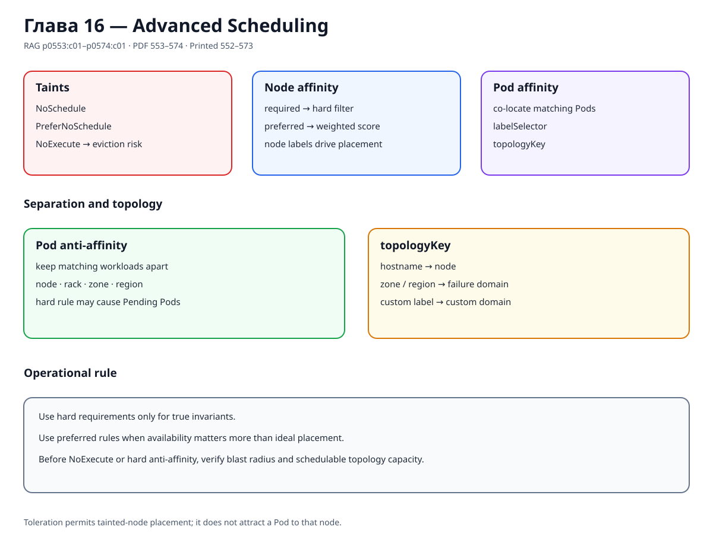
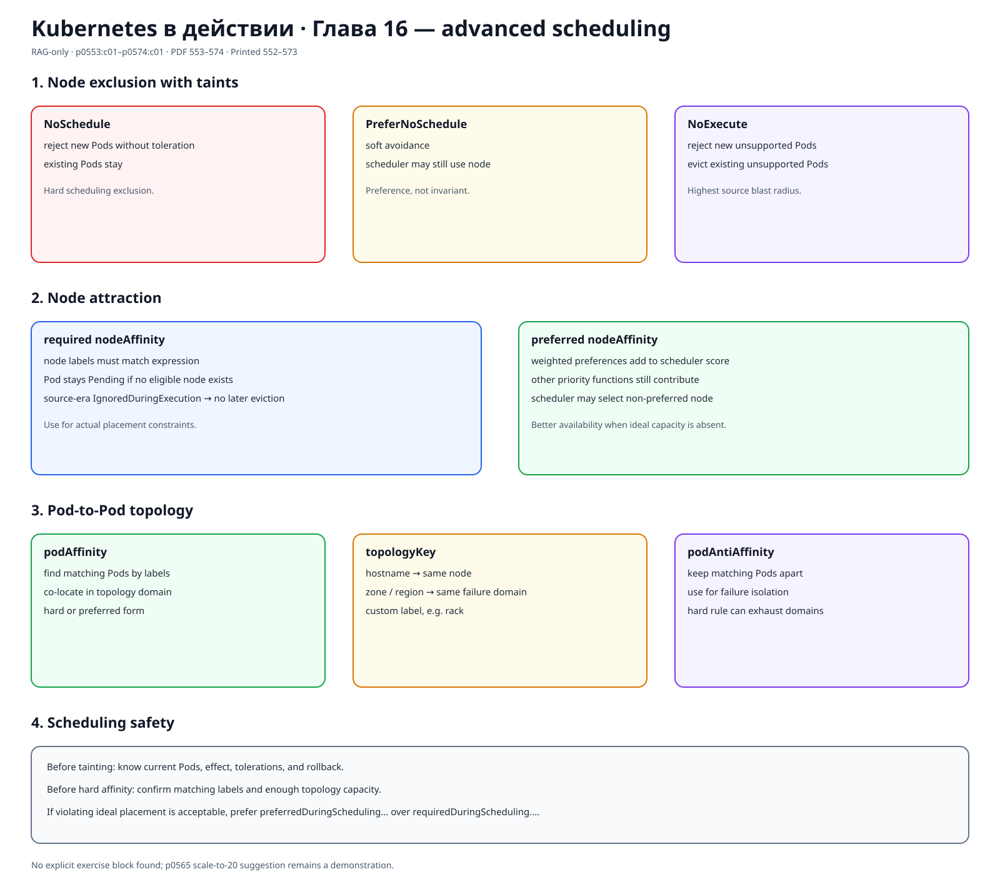

# Глава 16 — Продвинутое назначение модулей узлам

Практические и концептуальные заметки по главе 16 книги «Kubernetes в действии» Марко Лукши.

## Идентификация

- Book ID: kubernetes-in-action-marko-luksa-ru
- Глава: 16
- Slug: advanced-scheduling
- Source policy: rag_only
- External sources: запрещены
- Model memory: запрещена
- Прямой доступ к canonical PDF: не использовался

## Provenance

- RAG chunks: p0553:c01–p0574:c01
- PDF pages: 553–574
- Printed pages: 552–573
- p0553:c01 начинается заголовком главы 16.
- p0574:c01 содержит явный раздел 16.4 Резюме.
- p0575:c01 начинает главу 17.
- Chapter boundary verified: yes
- Source SHA-256: 0d50f167ed86088d0cc65d15e27f1ab397e7c0a0c8de4db3801b50439f24266f

## Содержимое

- [cheatsheet.md](cheatsheet.md) — taints/tolerations, node affinity, pod affinity/anti-affinity и topologyKey.
- [commands.md](commands.md) — source-confirmed команды с operational classification.
- [diagram.md](diagram.md) — Mermaid-схемы advanced scheduling.
- [summary.md](summary.md) — RAG-grounded резюме раздела 16.4.
- [visual-cheatsheet.svg](visual-cheatsheet.svg)
- [visual-cheatsheet-detailed.svg](visual-cheatsheet-detailed.svg)

## Conditional artifacts

- review-questions.md: не создан — отдельного явно обозначенного exercise block в проверенной границе нет.
- review-answers.md: не создан по той же причине.
- Формулировка «можете попробовать промасштабировать развертывание до 20 модулей» в p0565 рассматривается как demonstration.

## Карта главы

1. Taint описывает restriction на node.
2. Toleration позволяет Pod допустить конкретный taint.
3. Toleration разрешает scheduling на tainted node, но сама по себе не гарантирует placement именно туда.
4. NoSchedule запрещает новое назначение Pods без соответствующего toleration.
5. PreferNoSchedule — мягкое preference: scheduler старается избегать node, но может использовать его.
6. NoExecute влияет также на уже работающие Pods и может их вытеснить.
7. Node может иметь несколько taints, Pod — несколько tolerations.
8. Toleration operator Equal сопоставляет key/value/effect.
9. Operator Exists допускает любое value для заданного key.
10. Source default NoExecute tolerations для notReady/unreachable используют tolerationSeconds=300.
11. Taint/toleration можно использовать для partitioning cluster и special hardware.
12. nodeSelector — простая жёсткая фильтрация по node labels.
13. nodeAffinity делает node-selection более выразительным.
14. requiredDuringSchedulingIgnoredDuringExecution — жёсткое requirement при scheduling.
15. Source-era IgnoredDuringExecution означает, что изменение labels после scheduling не вытесняет уже работающий Pod.
16. preferredDuringSchedulingIgnoredDuringExecution задаёт preference, а не requirement.
17. Preferred node affinity использует weights для относительной важности правил.
18. Scheduler combining multiple priority functions может выбрать node, который не имеет максимального node-affinity score.
19. Pod affinity размещает Pod рядом с другими Pods по labelSelector.
20. required podAffinity может потребовать same node при topologyKey=kubernetes.io/hostname.
21. topologyKey определяет topology domain, а не конкретный node.
22. Source examples используют hostname, zone и region topology keys.
23. Custom topologyKey возможен через собственные node labels, например rack.
24. По умолчанию pod affinity selector source matching ограничен тем же namespace; поле namespaces расширяет scope.
25. preferred podAffinity задаёт soft co-location preference.
26. Pod anti-affinity удерживает Pods подальше от Pods, matching selector.
27. required podAntiAffinity может сделать Pods unschedulable, если topology domains закончились.
28. preferred podAntiAffinity выражает preference вместо жёсткого запрета.
29. topologyKey anti-affinity может разносить Pods по node/rack/zone/region.
30. Taints/tolerations и affinity решают разные задачи: taint отталкивает Pods от node; affinity притягивает/размещает по labels/topology.

## Краткий анализ главы

Глава показывает, что scheduling policy в Kubernetes состоит не из одного механизма, а из нескольких независимых ограничений и предпочтений.

Taint находится на node и выражает отрицательное правило: «не назначай сюда Pod, если он это не допускает». Toleration находится в Pod и снимает это ограничение. Но toleration не является node selector: Pod с toleration всё ещё может быть назначен обычному node без taint. Source demonstration с production nodes подчёркивает эту разницу.

Эффект taint определяет severity. NoSchedule блокирует будущий placement. PreferNoSchedule делает node менее желательным. NoExecute идёт дальше и может вытеснять Pods, которые уже находятся на node. Поэтому NoExecute — наиболее сильный operational boundary.

Source показывает и failure-handling использование NoExecute. Pods получают tolerations для notReady/unreachable с tolerationSeconds=300. Это означает, что control plane ждёт заданный период перед тем, как перестать терпеть состояние node и переназначить workload.

nodeAffinity решает противоположную задачу: Pod описывает, какие node labels обязательны или предпочтительны. requiredDuringSchedulingIgnoredDuringExecution — жёсткое condition. preferredDuringSchedulingIgnoredDuringExecution — scoring preference. Source-era IgnoredDuringExecution означает, что после запуска изменение labels не инициирует eviction.

Weights preferred node affinity не являются абсолютной командой scheduler. Source example показывает, что другие scheduler priority functions, например spread logic, тоже участвуют в итоговом score. Поэтому «prefer zone1» не означает «все Pods обязательно окажутся в zone1».

podAffinity связывает placement одного workload с фактическим placement другого. labelSelector определяет reference Pods, а topologyKey определяет область co-location. При hostname это один node; при zone/region — соответствующая topology domain; custom node label может описывать, например, rack.

Pod anti-affinity строится симметрично и нужен для failure-domain distribution либо performance isolation. Жёсткое required anti-affinity может сделать часть replicas Pending: source example на двух nodes с пятью frontend replicas и hostname anti-affinity запускает только две replicas, остальные некуда назначить.

Главная operational идея главы: hard requirements должны применяться только там, где нарушение placement действительно недопустимо. Если правило является желательным, но не обязательным, source рекомендует preferred form, чтобы scheduler сохранял возможность разместить workload при нехватке ideal capacity.

## Основной принцип

~~~text
Taint on Node
  → repels Pods

Toleration on Pod
  → permits placement despite taint
  → does not attract Pod

Node affinity
  → Pod selects/prefer Nodes by node labels

Pod affinity
  → Pod wants to be near matching Pods

Pod anti-affinity
  → Pod wants to be away from matching Pods

topologyKey
  → defines "near" / "away" domain
~~~

## Operational boundaries

- Adding/changing node taints changes scheduler eligibility.
- NoExecute can evict already running Pods.
- Changing node labels changes future affinity placement.
- required affinity/anti-affinity can create unschedulable Pending Pods.
- Preferred rules reduce placement rigidity and usually lower deadlock risk.
- Source-era topology labels and scheduler priority names are preserved without modernization.

## Ограничения

- API versions, label keys, scheduler priority names and topology keys are kept at source-era level.
- Modern topology label replacements are not introduced.
- Exact taint-removal rollback command is not present in verified source excerpts and is not reconstructed.
- Exact imperative scale command for p0565 demonstration is not reconstructed.
- No external documentation was used.
