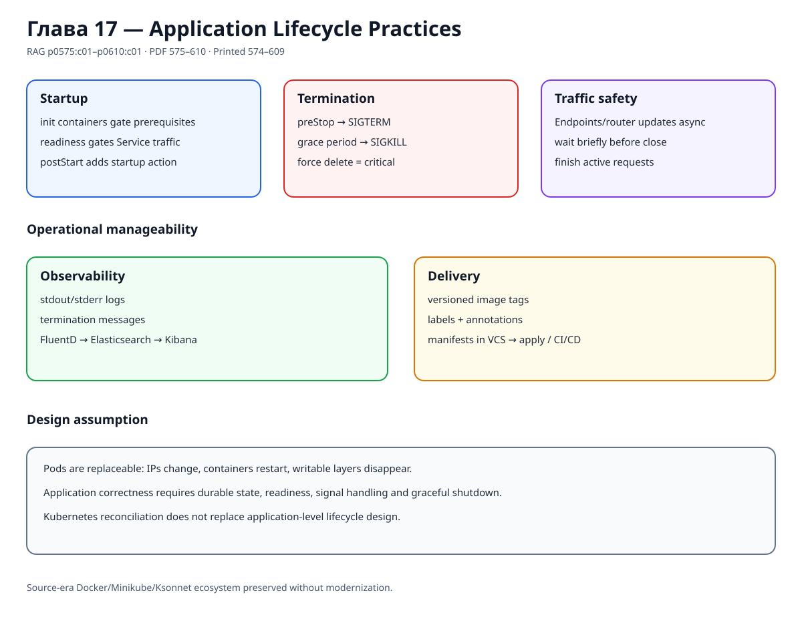
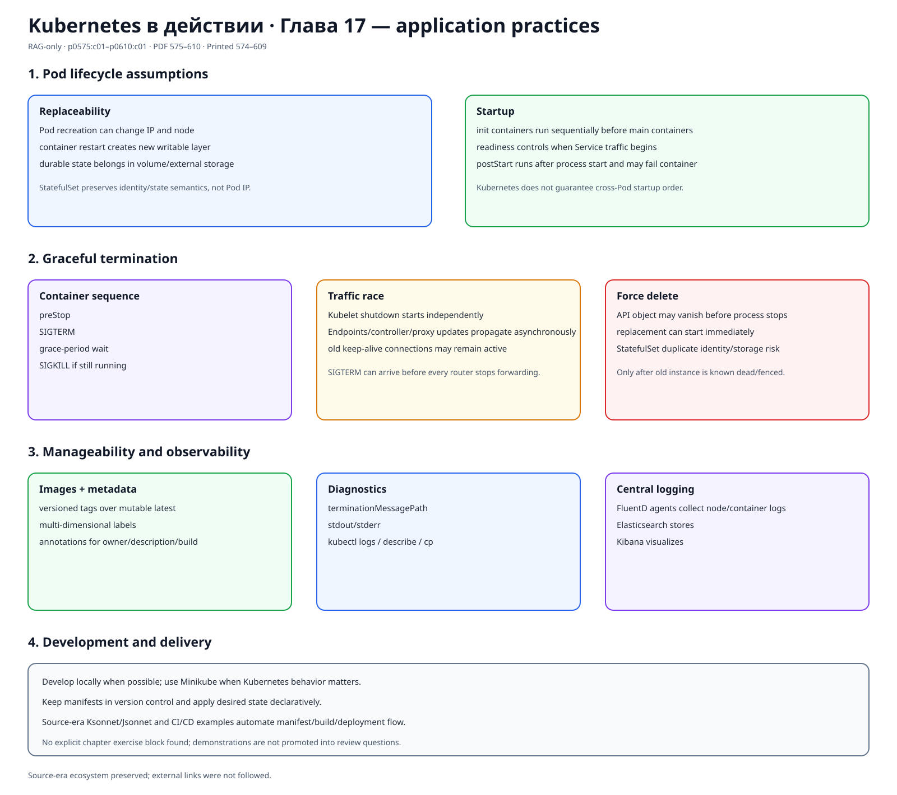

# Глава 17 — Рекомендации по разработке приложений

Практические и концептуальные заметки по главе 17 книги «Kubernetes в действии» Марко Лукши.

## Идентификация

- Book ID: kubernetes-in-action-marko-luksa-ru
- Глава: 17
- Slug: application-development-best-practices
- Source policy: rag_only
- External sources: запрещены
- Model memory: запрещена
- Прямой доступ к canonical PDF: не использовался

## Provenance

- RAG chunks: p0575:c01–p0610:c01
- PDF pages: 575–610
- Printed pages: 574–609
- p0575:c01 начинается заголовком главы 17.
- p0609:c01–p0610:c01 содержат явный раздел 17.6 Резюме.
- p0611:c01 начинает главу 18.
- Chapter boundary verified: yes
- Source SHA-256: 0d50f167ed86088d0cc65d15e27f1ab397e7c0a0c8de4db3801b50439f24266f

## Содержимое

- [cheatsheet.md](cheatsheet.md) — lifecycle, init containers, graceful shutdown, request handling, image/logging/dev practices.
- [commands.md](commands.md) — source-confirmed команды с operational classification.
- [diagram.md](diagram.md) — Mermaid-схемы lifecycle и operational flows.
- [summary.md](summary.md) — RAG-grounded резюме раздела 17.6.
- [visual-cheatsheet.svg](visual-cheatsheet.svg)
- [visual-cheatsheet-detailed.svg](visual-cheatsheet-detailed.svg)

## Conditional artifacts

- review-questions.md: не создан — отдельного явно обозначенного exercise block в проверенной границе нет.
- review-answers.md: не создан по той же причине.
- Формулировки «можете попробовать» в lifecycle examples рассматриваются как demonstrations.

## Карта главы

1. Типичное приложение объединяет Deployment/StatefulSet, Services, probes, ConfigMap/Secret, storage, HPA и другие resources.
2. Приложения должны ожидать частого удаления и повторного создания Pods.
3. Pod IP может измениться; StatefulSet сохраняет stable identity, но не Pod IP.
4. Данные в writable layer container теряются при restart container.
5. Volume нужен, если данные должны переживать restart container внутри того же Pod.
6. ReplicaSet не заменяет Pod только потому, что container внутри него находится в CrashLoopBackOff.
7. Kubernetes не гарантирует порядок запуска отдельных Pods/resources.
8. Init containers выполняются последовательно до запуска main containers.
9. Init container может ждать external/service prerequisite.
10. postStart запускается после старта main process, но не ждёт завершения его application initialization.
11. Неуспешный postStart может привести к уничтожению main container.
12. preStop выполняется перед SIGTERM при termination container.
13. preStop относится к container lifecycle и может выполняться при restart container, не только при удалении Pod.
14. Приложение должно корректно обрабатывать SIGTERM.
15. Source рекомендует запускать application binary напрямую либо корректно forward signals из shell.
16. terminationGracePeriodSeconds ограничивает время graceful shutdown; source default — 30 секунд.
17. После grace period Kubelet применяет SIGKILL, если process не завершился.
18. Force-delete API object может создать replacement раньше фактического завершения старого Pod.
19. Для StatefulSet это может нарушить at-most-one assumption и привести к двум экземплярам одной identity.
20. Readiness probe должна становиться successful только когда application действительно готово принимать traffic.
21. При termination distributed update Endpoints/kube-proxy происходит параллельно с SIGTERM.
22. Existing keep-alive connections не исчезают из-за удаления iptables rule.
23. Source рекомендует небольшую preStop delay, чтобы дать routing components время перестать направлять новые connections.
24. После delay application должно прекратить новые connections, закрыть idle keep-alive и дождаться active requests.
25. Container images должны быть достаточно небольшими, но operational debug tooling может быть полезен.
26. Source рекомендует versioned image tags вместо mutable latest для production-like usage.
27. imagePullPolicy Always заставляет runtime проверять registry на каждом новом Pod startup.
28. Multi-dimensional labels упрощают группировку resources.
29. Annotations полезны для description, owner/contact и operational metadata.
30. terminationMessagePath позволяет process передать reason termination в Pod status.
31. Applications should log to stdout/stderr для kubectl logs.
32. Logs previous container доступны через source-described --previous option.
33. kubectl cp позволяет переносить файлы в/из container.
34. Central logging source example: FluentD + Elasticsearch + Kibana.
35. Local development не обязательно выполнять внутри Kubernetes.
36. Source допускает локальный access к cluster services/API при корректных credentials/permissions.
37. Minikube можно использовать для local manifests и image iteration.
38. eval $(minikube docker-env) переключает local Docker CLI на daemon внутри Minikube VM.
39. Resource manifests следует version-control и применять declaratively.
40. Source приводит kube-applier как continuous apply example.
41. Source-era Ksonnet/Jsonnet рассматриваются как способ шаблонизации manifests.
42. CI/CD должен автоматизировать build binaries, images, manifests и deployment.

## Краткий анализ главы

Глава 17 — operational synthesis всей книги. Она смещает фокус с отдельных Kubernetes resources на поведение application в реальном lifecycle.

Главный принцип: Pod не является стабильной машиной. Он может быть пересоздан, получить новый IP, container внутри него может restart, а writable layer исчезает. Поэтому application должна хранить durable state в подходящем storage и не связывать membership/identity с transient Pod IP.

Kubernetes также не гарантирует application-level startup ordering. Init containers дают локальный механизм prerequisite внутри Pod: они выполняются последовательно, и main containers запускаются только после успешного завершения init chain.

Lifecycle hooks являются дополнением, а не заменой корректной application lifecycle logic. postStart может запускать дополнительную initialization работу, но main process уже стартован параллельно. preStop выполняется перед SIGTERM и может использоваться для shutdown preparation. Source подчёркивает, что приложение само должно нормально реагировать на SIGTERM.

Graceful termination представляет распределённую проблему. Удаление Pod запускает несколько независимых цепочек: Kubelet начинает shutdown, controller обновляет Endpoints, kube-proxy и другие traffic components обновляют routing asynchronously. Поэтому process может получить SIGTERM до того, как все новые traffic paths исчезнут. Source предлагает practical mitigation: небольшая delay, затем stop accepting new connections, close idle keep-alives, wait active requests, exit.

Readiness решает обратную проблему startup: Pod не должен попадать в Service Endpoints до фактической готовности application.

Force deletion — особая граница. Source предупреждает, что API object может исчезнуть раньше реального process termination. Для StatefulSet это может привести к одновременному существованию старого и replacement instance с одной logical identity/storage.

Остальная глава формирует управляемость application: deterministic image versions, полезные labels/annotations, termination messages, stdout logging, central log collection, version-controlled manifests и declarative delivery.

Development workflow отделён от production runtime. Source не требует, чтобы каждый edit проходил полный build/push/deploy цикл. Приложение можно запускать локально, использовать Minikube, переключать Docker daemon, а manifests хранить в VCS и применять автоматически.

## Основной принцип

~~~text
Application design
  → tolerate Pod recreation
  → durable state outside container writable layer
  → explicit readiness
  → graceful SIGTERM handling
  → observable termination/logging

Deployment practice
  → immutable/versioned artifacts
  → labels + annotations
  → manifests in VCS
  → declarative apply / CI/CD
~~~

## Critical operational boundaries

- force-delete может удалить API object без подтверждения фактической остановки workload.
- StatefulSet force-delete может нарушить at-most-one guarantee.
- слишком короткий termination grace period может привести к SIGKILL и оборванным requests.
- слишком длинный preStop/grace period задерживает rollout/deletion.
- readiness misconfiguration может направить traffic в неготовое application.
- копирование ServiceAccount credentials на development machine расширяет credential exposure boundary.
- imagePullPolicy Always создаёт runtime dependency от registry availability.

## Ограничения

- Source-era Docker, Minikube, kube-proxy/iptables, Ksonnet, Heapster-era ecosystem framing сохраняется без modernization.
- Exact kubectl command for --previous logs is not shown as a full listing and is not reconstructed.
- External links to Fabric8, kube-applier, Ksonnet and Google labs are not followed.
- No modern GitOps or service-mesh behavior is substituted.
