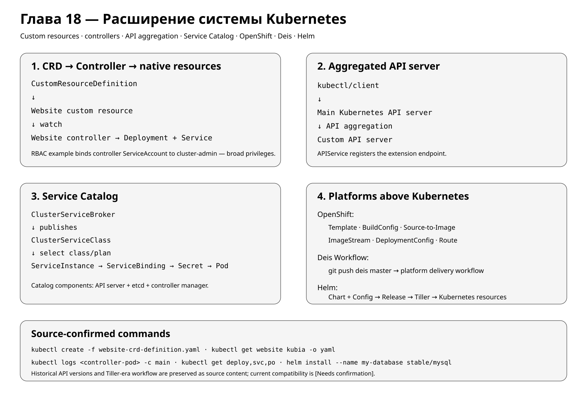

# Глава 18 — Расширение системы Kubernetes

Практические и концептуальные заметки по заключительной главе книги «Kubernetes в действии» Марко Лукши.




## Идентификация

- Book ID: `kubernetes-in-action-marko-luksa-ru`
- Глава: 18
- Slug: `extending-kubernetes`
- Source policy: `rag_only`
- External sources: запрещены
- Model memory: запрещена
- Прямой доступ к canonical PDF: не использовался

## Provenance

- RAG chunks: `p0611:c01–p0639:c01`
- PDF pages: 611–639
- Printed pages: 610–638
- `p0611:c01` начинается заголовком главы 18.
- `p0639:c01` содержит явный раздел 18.4 «Резюме».
- `p0640:c01` начинает приложение A.
- Chapter boundary verified: yes
- Source SHA-256: `0d50f167ed86088d0cc65d15e27f1ab397e7c0a0c8de4db3801b50439f24266f`

## Содержимое

- [cheatsheet.md](cheatsheet.md) — CRD, custom controllers, API aggregation, Service Catalog, OpenShift, Deis Workflow и Helm.
- [commands.md](commands.md) — только команды, явно присутствующие в RAG главы.
- [diagram.md](diagram.md) — Mermaid-схемы расширения Kubernetes.
- [summary.md](summary.md) — RAG-grounded перенос смысла раздела 18.4.
- [visual-cheatsheet.svg](visual-cheatsheet.svg)
- [visual-cheatsheet-detailed.svg](visual-cheatsheet-detailed.svg)

## Conditional artifacts

- `review-questions.md`: не создан — отдельного блока контрольных вопросов/упражнений в проверенной границе главы нет.
- `review-answers.md`: не создан по той же причине.

## Карта главы

1. Kubernetes допускает добавление собственных API-объектов через `CustomResourceDefinition`.
2. CRD задает группу API, версию, scope и имена пользовательского ресурса.
3. После регистрации CRD сервер API может хранить, отдавать и удалять экземпляры пользовательского ресурса.
4. Сам по себе пользовательский объект не обязан вызывать действие; для поведения нужен контроллер.
5. Пользовательский контроллер наблюдает ресурсы и создает/изменяет низкоуровневые объекты Kubernetes.
6. В примере `Website` контроллер создает `Deployment` и `Service`.
7. Для запуска контроллера внутри кластера используется отдельная `ServiceAccount`.
8. При включенном RBAC контроллеру нужны права на чтение пользовательского ресурса и создание связанных объектов.
9. Глава демонстрирует широкую привязку `cluster-admin` для учебного контроллера; это source-specific example, не универсальная рекомендация.
10. Пользовательский API можно расширять не только CRD, но и отдельным API server через API aggregation.
11. `APIService` регистрирует дополнительный API server в главном API Kubernetes.
12. Service Catalog строится как отдельная распределенная подсистема: API server, etcd и controller manager.
13. Service Catalog оперирует `ClusterServiceBroker`, `ClusterServiceClass`, `ServiceInstance` и `ServiceBinding`.
14. Broker публикует доступные классы служб.
15. Пользователь выбирает класс/план и создает `ServiceInstance`.
16. `ServiceBinding` связывает workload с экземпляром службы и приводит к появлению `Secret` с учетными данными.
17. OpenShift показан как PaaS-платформа поверх Kubernetes с дополнительными API-объектами.
18. В OpenShift шаблоны параметризуют наборы ресурсов.
19. `BuildConfig` и Source-to-Image автоматизируют сборку образов из исходного кода.
20. `ImageStream` и `DeploymentConfig` связывают появление новых образов с развертыванием.
21. `Route` предоставляет внешний доступ и дополнительную маршрутизационную конфигурацию.
22. Deis Workflow показан как PaaS, устанавливаемая поверх существующего Kubernetes.
23. Helm в версии, описанной книгой, состоит из CLI `helm` и серверного компонента Tiller.
24. Helm Chart + Config образуют Release, который создает необходимые Kubernetes resources.
25. Главная идея главы: Kubernetes можно расширять на уровнях API types, controllers, aggregated API servers и платформенных abstractions.

## Основной принцип

```text
Высокоуровневая декларация
        ↓
Custom Resource / ServiceInstance / Chart
        ↓
Controller / Broker / Tiller
        ↓
обычные Kubernetes resources
        ↓
Deployment / Service / Secret / PVC / Pods
```

Расширение Kubernetes в главе строится не вокруг обхода control plane, а вокруг добавления новых декларативных объектов и контроллеров, которые преобразуют их в обычные ресурсы кластера.

## Ограничения и границы

- Материал отражает API и инструменты эпохи книги: в тексте явно встречаются `v1beta1`, Kubernetes 1.7/1.8, Tiller и Service Catalog alpha-era APIs.
- Совместимость приведенных манифестов и команд с современным кластером: **[Needs confirmation]**.
- В этой коллекции не выполнялась модернизация source-era YAML под текущие API.
- Команды сохранены как учебные примеры источника; они не являются подтверждением production-safe конфигурации.
