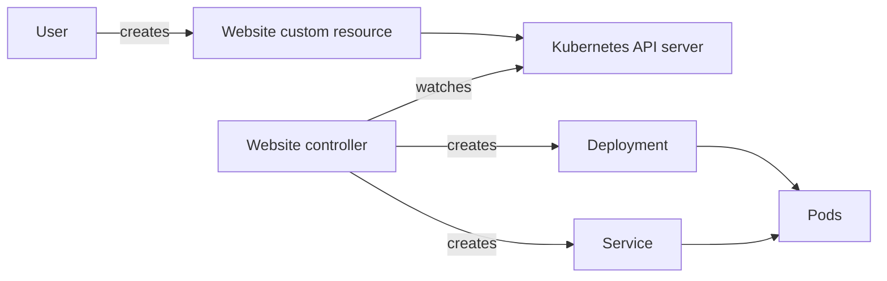
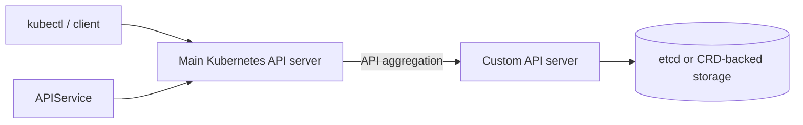
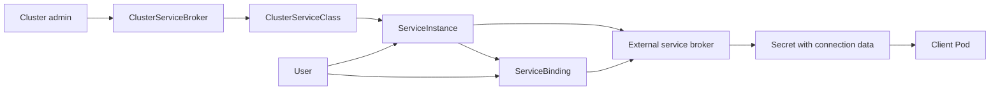
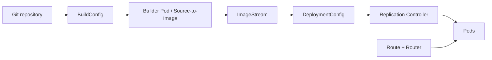
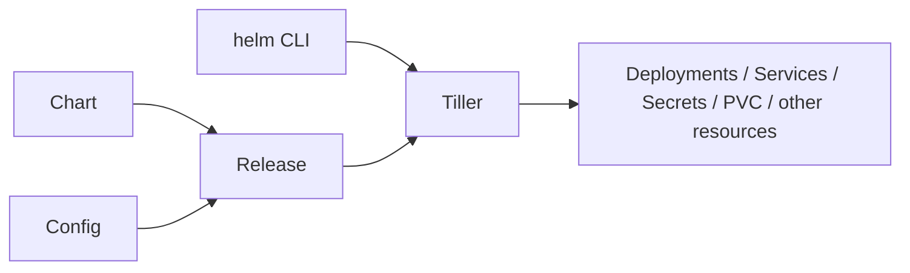
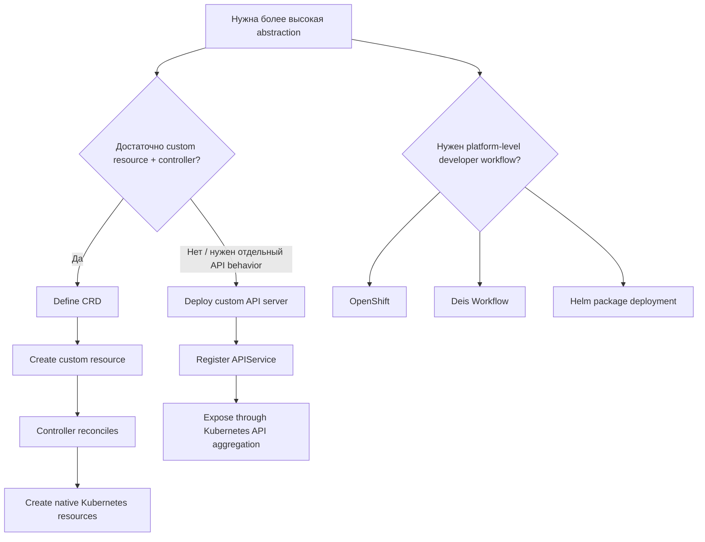

# Глава 18 — diagrams

## 1. CRD и пользовательский контроллер

## 2. Расширение API через aggregation

## 3. Service Catalog

## 4. OpenShift build/deploy flow

## 5. Helm architecture в источнике

## Логика главы

