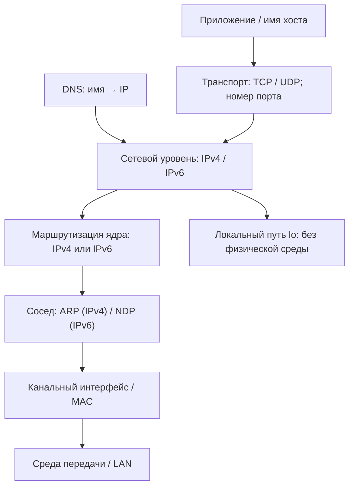
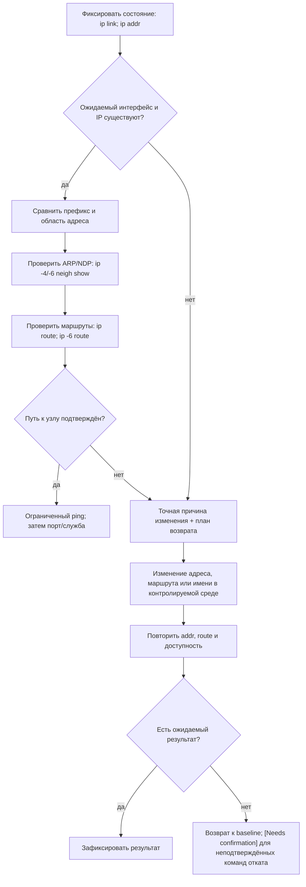

# Схема части I: структура и путь локализации

Первая часть посвящена **архитектуре и связям уровней**, не готовому универсальному скрипту ремонта. Графы ниже переносят только установленные в RAG отношения; картинки 1.1–1.5 из PDF не реконструируются.

## Протокольная модель

Основание: [PDF p. 11](../../../rag/chunks/p0001-p0100/p0011-c01.md), [PDF p. 19](../../../rag/chunks/p0001-p0100/p0019-c01.md), [PDF p. 20](../../../rag/chunks/p0001-p0100/p0020-c01.md), [PDF p. 35](../../../rag/chunks/p0001-p0100/p0035-c01.md), [PDF p. 46](../../../rag/chunks/p0001-p0100/p0046-c01.md), [PDF p. 54](../../../rag/chunks/p0001-p0100/p0054-c01.md), [PDF p. 59](../../../rag/chunks/p0001-p0100/p0059-c01.md). Конкретный набор заголовков инкапсуляции показан в книге на рисунке 1.3, но рисунок не извлечён как структурные данные RAG.

## Диагностическая последовательность

Основание: [PDF p. 20](../../../rag/chunks/p0001-p0100/p0020-c01.md), [PDF p. 38](../../../rag/chunks/p0001-p0100/p0038-c01.md), [PDF p. 46](../../../rag/chunks/p0001-p0100/p0046-c01.md), [PDF p. 48](../../../rag/chunks/p0001-p0100/p0048-c01.md), [PDF p. 55](../../../rag/chunks/p0001-p0100/p0055-c01.md), [PDF p. 56](../../../rag/chunks/p0001-p0100/p0056-c01.md), [PDF p. 57](../../../rag/chunks/p0001-p0100/p0057-c01.md), [PDF p. 60](../../../rag/chunks/p0001-p0100/p0060-c01.md). Путь является **синтезом логики главы**, а не дословным авторским алгоритмом. Откат не выдумывается.

Ограничения: проверка ping, DNS, telnet или nmap генерирует трафик; конфигурирование выполняется только в разрешённой среде. Несогласованные маски и уровни отмечены в [source-findings](source-findings.md).
