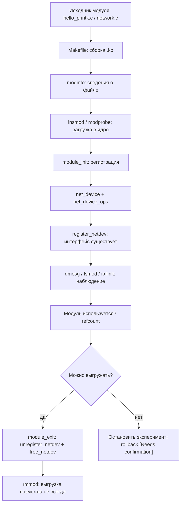
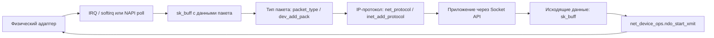
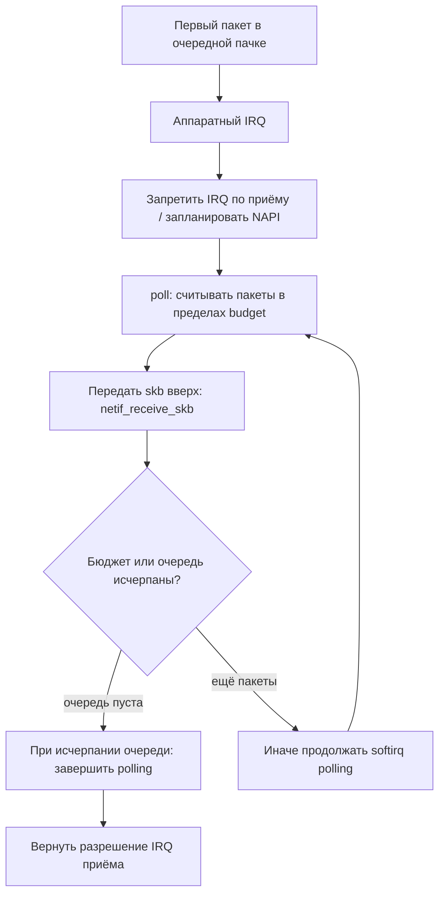

# Диаграммы части IV (Mermaid, RAG-only)

Схемы представляют причинно-следственные связи, описанные автором, но **не** являются копией оригинальных рисунков или готовыми планами развертывания.

## Жизненный цикл модуля и сетевого интерфейса

Источники: [PDF 190](../../../rag/chunks/p0101-p0200/p0190-c01.md), [PDF 191](../../../rag/chunks/p0101-p0200/p0191-c01.md), [PDF 192](../../../rag/chunks/p0101-p0200/p0192-c01.md), [PDF 193](../../../rag/chunks/p0101-p0200/p0193-c01.md), [PDF 194](../../../rag/chunks/p0101-p0200/p0194-c01.md), [PDF 199](../../../rag/chunks/p0101-p0200/p0199-c01.md), [PDF 200](../../../rag/chunks/p0101-p0200/p0200-c01.md), [PDF 207](../../../rag/chunks/p0201-p0300/p0207-c01.md), [PDF 208](../../../rag/chunks/p0201-p0300/p0208-c01.md), [PDF 209](../../../rag/chunks/p0201-p0300/p0209-c01.md). Схема концептуальная; наличие аппаратного драйвера, модуля и реальных callback зависит от эксперимента.

## Приём и передача сквозь сетевой стек

Источник: [PDF 200](../../../rag/chunks/p0101-p0200/p0200-c01.md), [PDF 201](../../../rag/chunks/p0201-p0300/p0201-c01.md), [PDF 202](../../../rag/chunks/p0201-p0300/p0202-c01.md), [PDF 203](../../../rag/chunks/p0201-p0300/p0203-c01.md), [PDF 205](../../../rag/chunks/p0201-p0300/p0205-c01.md), [PDF 206](../../../rag/chunks/p0201-p0300/p0206-c01.md), [PDF 208](../../../rag/chunks/p0201-p0300/p0208-c01.md), [PDF 219](../../../rag/chunks/p0201-p0300/p0219-c01.md), [PDF 232](../../../rag/chunks/p0201-p0300/p0232-c01.md). Метки L2/L4 служат краткой классификацией API по назначениям; спорное именование автором «сетевого уровня» L2 и L3 отдельно сохранено в findings.

## NAPI — совмещение прерывания и опроса

Источник: [PDF 202](../../../rag/chunks/p0201-p0300/p0202-c01.md), [PDF 203](../../../rag/chunks/p0201-p0300/p0203-c01.md), [PDF 204](../../../rag/chunks/p0201-p0300/p0204-c01.md), [PDF 205](../../../rag/chunks/p0201-p0300/p0205-c01.md). Упомянутые функции и состояния NAPI в книге историчны; текущее состояние API ядра **[Needs confirmation]**.

## Операционный контур безопасности

Сначала наблюдать `uname -r`, `lsmod`, `dmesg`, `ip link`; затем проверить исходники на корректный `skb`-lifetime; после — только в VM с восстановлением экспериментировать с загрузкой модуля и регистрацией интерфейса; наконец подтвердить `dmesg`, состояние интерфейса и тест с разрешённым клиентом. Удаление/откат зависит от состояния счётчика ссылок и правильной реализации `module_exit`. [PDF 193](../../../rag/chunks/p0101-p0200/p0193-c01.md), [PDF 199](../../../rag/chunks/p0101-p0200/p0199-c01.md), [PDF 207](../../../rag/chunks/p0201-p0300/p0207-c01.md), [PDF 220](../../../rag/chunks/p0201-p0300/p0220-c01.md), [PDF 222](../../../rag/chunks/p0201-p0300/p0222-c01.md), [PDF 224](../../../rag/chunks/p0201-p0300/p0224-c01.md).

Срочные вопросы до любых экспериментов: `kfree_skb(skb)` с последующим доступом к `skb`, `dev_queue_xmit(skb)` с последующим логированием из `skb`, переменные `irq/byte`. См. [source-findings.md](source-findings.md).
