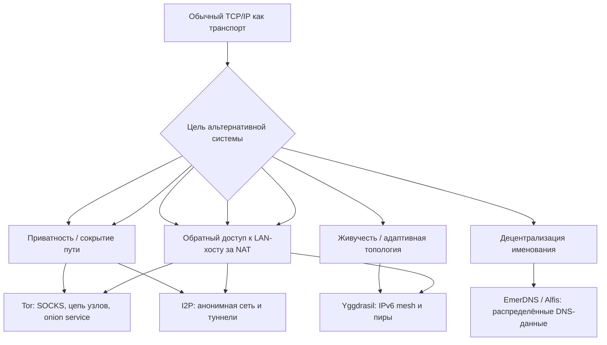
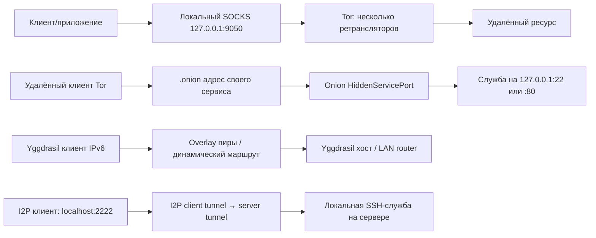
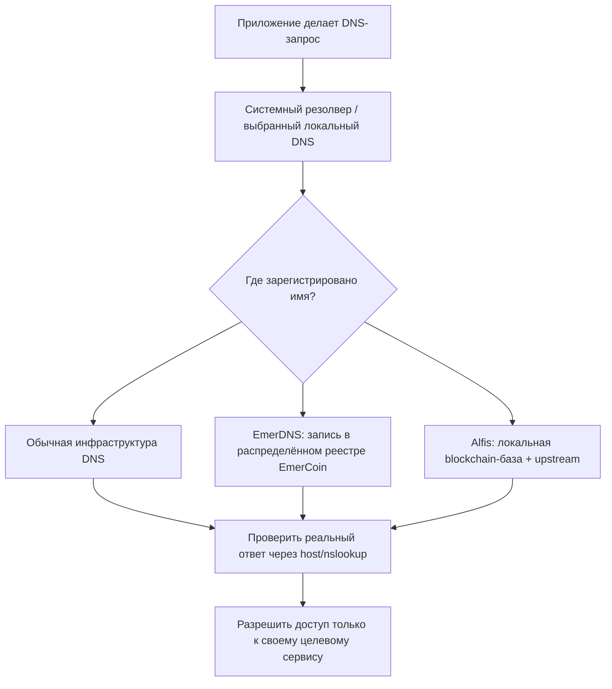

# Часть V — концептуальные схемы (Mermaid)

Эти диаграммы синтезированы только из RAG-текста PDF 235–302. Это не копии авторских рисунков 5.1–5.17.

## Разные цели и механизмы «надсистем»

Основание: [PDF 235](../../../rag/chunks/p0201-p0300/p0235-c01.md), [PDF 236](../../../rag/chunks/p0201-p0300/p0236-c01.md), [PDF 237](../../../rag/chunks/p0201-p0300/p0237-c01.md), [PDF 244](../../../rag/chunks/p0201-p0300/p0244-c01.md), [PDF 270](../../../rag/chunks/p0201-p0300/p0270-c01.md), [PDF 278](../../../rag/chunks/p0201-p0300/p0278-c01.md), [PDF 280](../../../rag/chunks/p0201-p0300/p0280-c01.md), [PDF 290](../../../rag/chunks/p0201-p0300/p0290-c01.md), [PDF 297](../../../rag/chunks/p0201-p0300/p0297-c01.md).

## Два разных сценария доступа через overlay

Основание: [PDF 239](../../../rag/chunks/p0201-p0300/p0239-c01.md), [PDF 241](../../../rag/chunks/p0201-p0300/p0241-c01.md), [PDF 242](../../../rag/chunks/p0201-p0300/p0242-c01.md), [PDF 244](../../../rag/chunks/p0201-p0300/p0244-c01.md), [PDF 264](../../../rag/chunks/p0201-p0300/p0264-c01.md), [PDF 265](../../../rag/chunks/p0201-p0300/p0265-c01.md), [PDF 276](../../../rag/chunks/p0201-p0300/p0276-c01.md), [PDF 277](../../../rag/chunks/p0201-p0300/p0277-c01.md), [PDF 278](../../../rag/chunks/p0201-p0300/p0278-c01.md), [PDF 297](../../../rag/chunks/p0201-p0300/p0297-c01.md), [PDF 298](../../../rag/chunks/p0201-p0300/p0298-c01.md), [PDF 299](../../../rag/chunks/p0201-p0300/p0299-c01.md), [PDF 300](../../../rag/chunks/p0201-p0300/p0300-c01.md). Схема показывает **разные** примеры книги, не универсальную совместимость overlay-протоколов. Публикация локальной службы требует отдельного разрешения.

## Альтернативное DNS и приёмка

Основание: [PDF 279](../../../rag/chunks/p0201-p0300/p0279-c01.md), [PDF 280](../../../rag/chunks/p0201-p0300/p0280-c01.md), [PDF 286](../../../rag/chunks/p0201-p0300/p0286-c01.md), [PDF 287](../../../rag/chunks/p0201-p0300/p0287-c01.md), [PDF 288](../../../rag/chunks/p0201-p0300/p0288-c01.md), [PDF 289](../../../rag/chunks/p0201-p0300/p0289-c01.md), [PDF 290](../../../rag/chunks/p0201-p0300/p0290-c01.md), [PDF 292](../../../rag/chunks/p0201-p0300/p0292-c01.md), [PDF 293](../../../rag/chunks/p0201-p0300/p0293-c01.md), [PDF 296](../../../rag/chunks/p0201-p0300/p0296-c01.md).

## Контроль изменения системы

`baseline → локальная диагностика → разрешённая сетевая проба → контролируемое изменение → повторная проверка → сохранить/отменить`. Команды со статусом read-only (`netstat`, `ip`, `getPeers`) не равны сетевым пробам `curl/ping/iperf` и тем более изменениям конфигурации `HiddenServicePort/Peers/sysctl`. Для завершённого rollback технических данных книги недостаточно: **[Needs confirmation]**. [PDF 239](../../../rag/chunks/p0201-p0300/p0239-c01.md), [PDF 253](../../../rag/chunks/p0201-p0300/p0253-c01.md), [PDF 265](../../../rag/chunks/p0201-p0300/p0265-c01.md), [PDF 267](../../../rag/chunks/p0201-p0300/p0267-c01.md), [PDF 268](../../../rag/chunks/p0201-p0300/p0268-c01.md), [PDF 293](../../../rag/chunks/p0201-p0300/p0293-c01.md), [PDF 300](../../../rag/chunks/p0201-p0300/p0300-c01.md).
