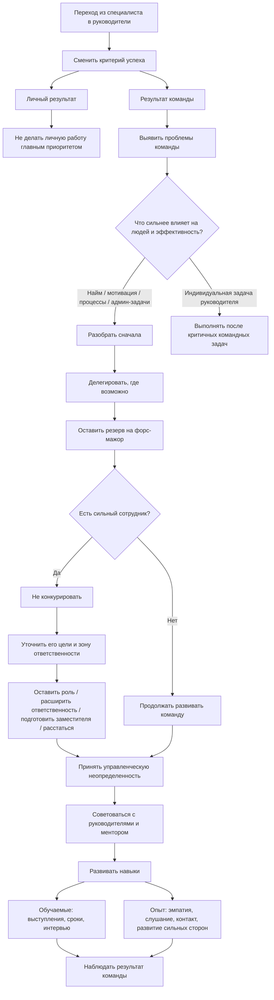

# Diagram — глава 1 «Вы стали руководителем»

## Interpretation

Диаграмма отражает основную смену парадигмы главы: руководитель перестает считать собственную индивидуальную производительность главным результатом и организует среду, в которой команда способна выполнять работу качественно и в срок.
