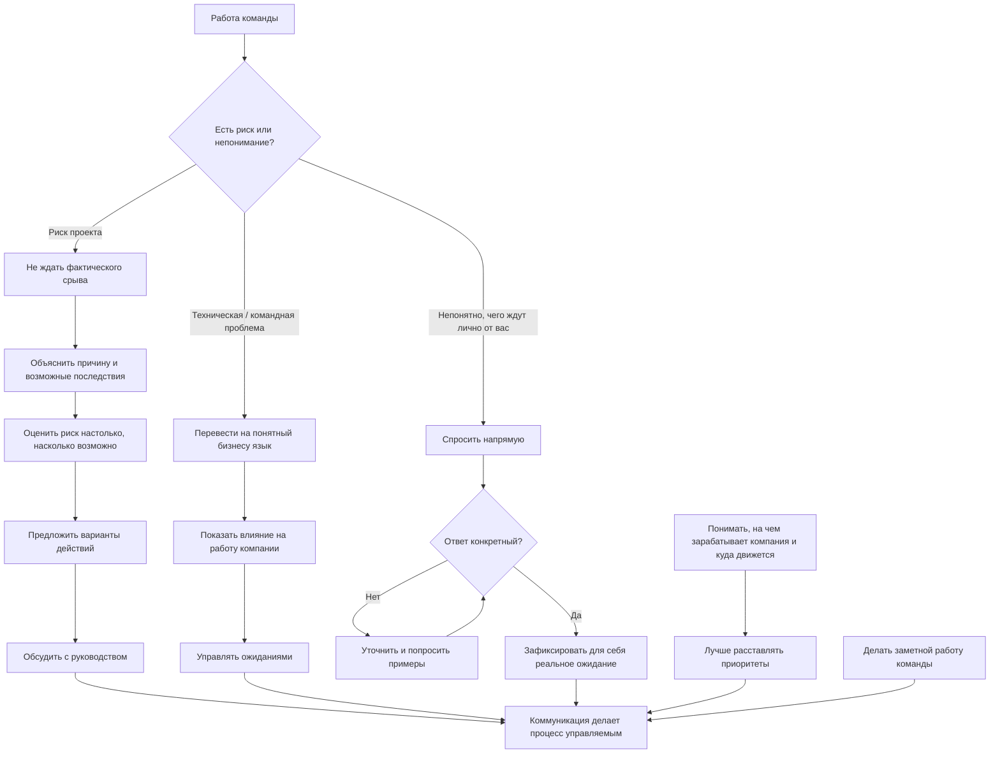

# Diagram — глава 2 «Вы и начальство»

## Interpretation

Глава связывает отношения с начальством не с «подчинением ради подчинения», а с качеством информации: руководитель команды должен рано поднимать риски, объяснять смысл решений в бизнес-контексте, показывать результаты и устранять неопределенность прямыми вопросами.
