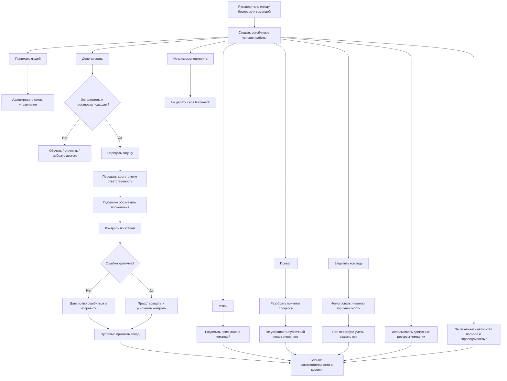

# Diagram — глава 3 «Вы и команда»

## Interpretation

Глава связывает эффективность команды с несколькими взаимозависимыми механизмами: адаптивным стилем общения, качественным делегированием, реальной передачей ответственности, ограничением микроменеджмента, справедливым распределением признания и ответственности, защитой сотрудников и постепенно заработанным авторитетом.
