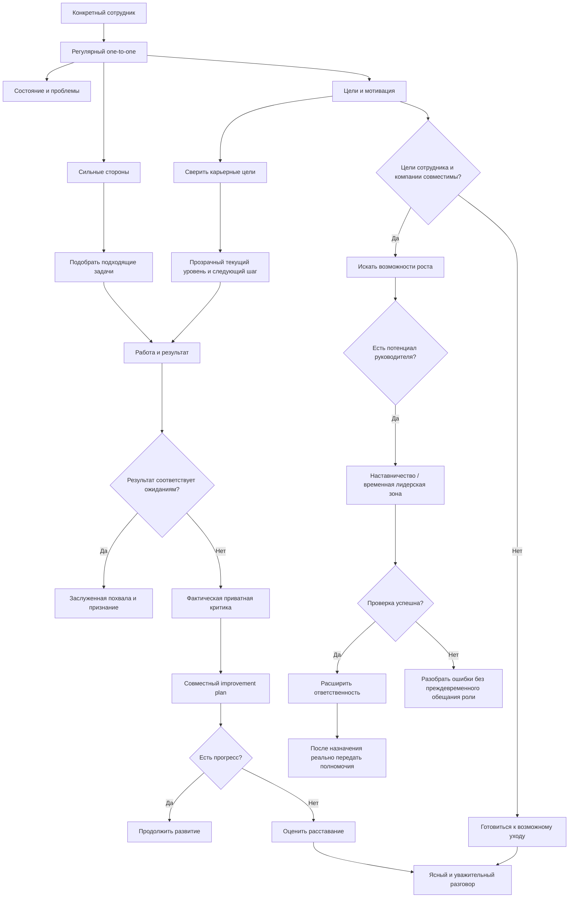

# Diagram — глава 4 «Работа с индивидуальностью»

## Interpretation

Глава предлагает управлять не абстрактной «мотивацией персонала», а конкретной траекторией человека: понимать его сильные стороны и цели, заранее задавать критерии, регулярно давать обратную связь и не смешивать развитие сотрудника с попыткой переделать его личность.
