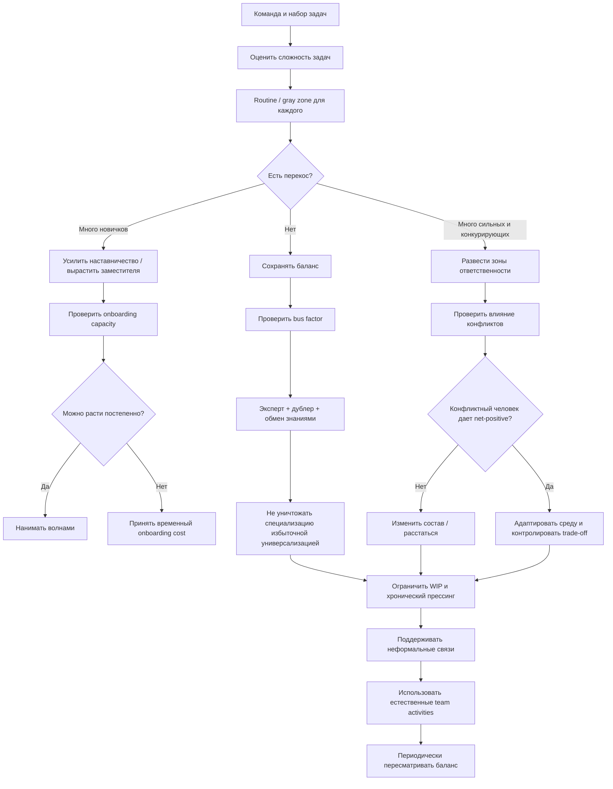

# Diagram — глава 5 «Создаем слаженную команду»

## Interpretation

Глава рассматривает команду как динамическую систему. Нельзя оптимизировать только индивидуальную производительность: состав, распределение знаний, стоимость обучения, конфликты, давление сроков и человеческие связи влияют друг на друга.
