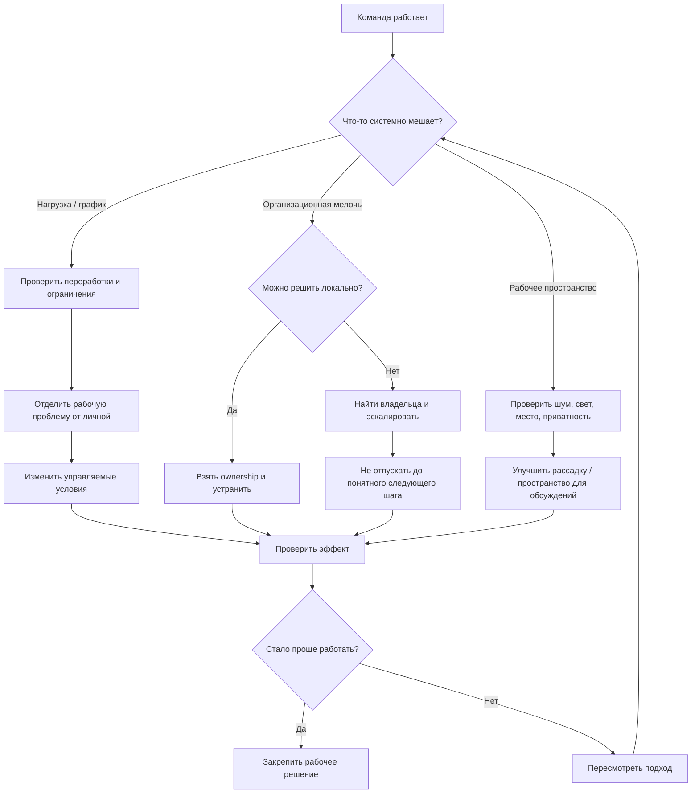

# Diagram — глава 6 «Забота как часть работы»

## Interpretation

Глава связывает заботу не с опекой ради опеки, а с устранением факторов, которые мешают команде выполнять интеллектуальную работу: хронической усталости, организационного friction и неудобной физической среды.
