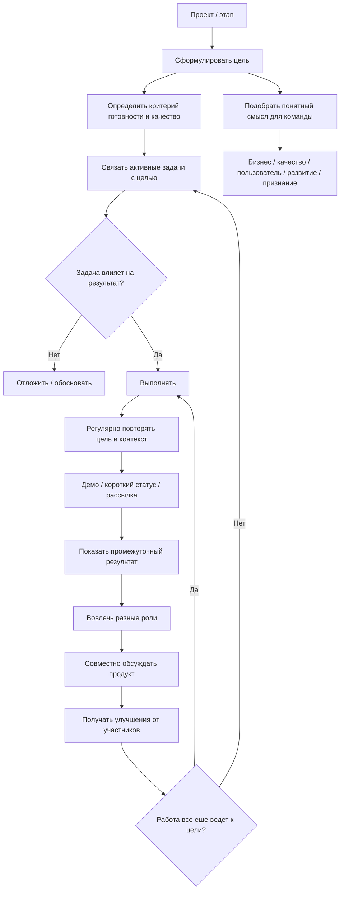

# Diagram — глава 7 «Целеполагание»

## Interpretation

Глава показывает целеполагание не как разовое объявление цели, а как непрерывный цикл фокусировки: цель, критерии, повтор контекста, демонстрация результата и вовлечение участников в конечный продукт.
