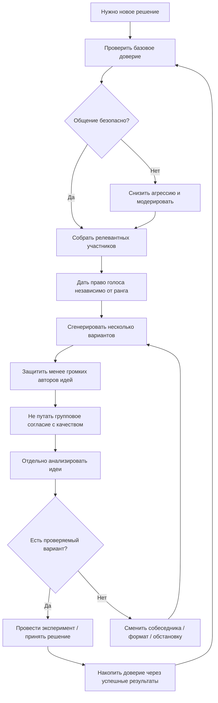

# Diagram — глава 8 «Секреты творческой атмосферы»

## Interpretation

Творческая среда в главе — это не отсутствие критики. Это система, где идеи сначала получают шанс быть услышанными, а затем проходят содержательную проверку без подавления автора статусом, грубостью или динамикой группы.
