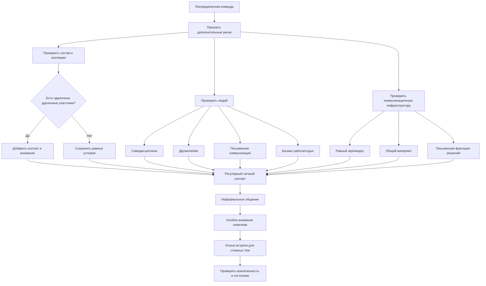

# Diagram — глава 9 «Работа с распределенной командой»

## Interpretation

Глава рассматривает distributed work как систему с дополнительной стоимостью координации. Эффективность зависит не от самого факта удаленности, а от того, компенсирует ли руководитель потерю неформального контекста, слабую наблюдаемость состояния людей и неравенство доступа к информации.
