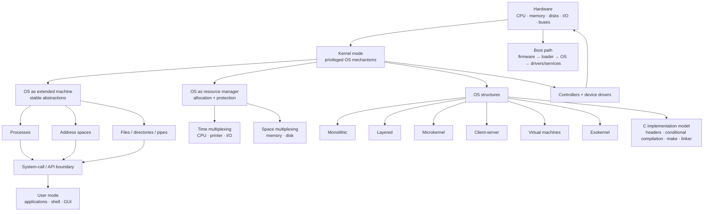

# Chapter 1 conceptual flow



## Reading path

```text
raw hardware
   ↓ hidden/controlled by
operating system
   ├─ abstractions for applications
   └─ resource allocation/protection
            ↓
       system-call/API boundary
            ↓
 processes · memory · files · I/O · security
            ↓
 detailed mechanisms in later chapters
```
