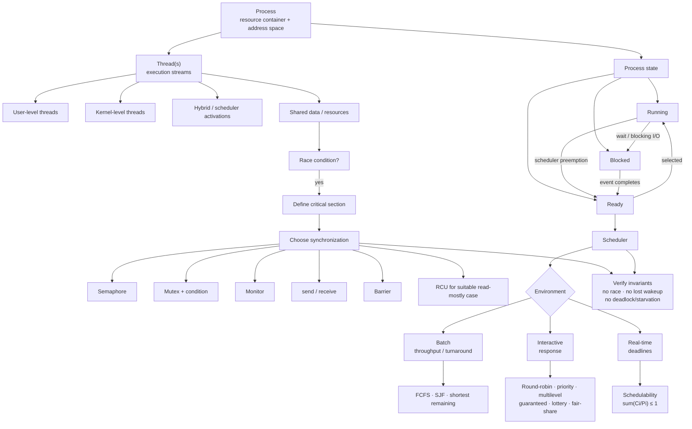

# Chapter 2 conceptual / diagnostic flow



## Operational reading

```text
not progressing
  ├─ blocked? → identify awaited event
  ├─ ready?   → inspect scheduling/fairness
  ├─ running? → useful work or spin?
  └─ shared state? → race / lock / ordering / deadlock analysis
```
