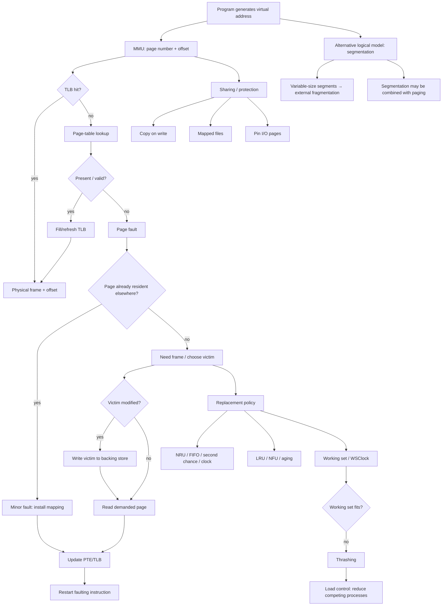

# Chapter 3 conceptual / diagnostic flow



## Diagnostic distinction

```text
memory access problem
  ├─ invalid/protection → protection/addressing path
  ├─ TLB miss          → translation-cache path
  ├─ minor fault       → mapping path; no disk read required
  ├─ major fault       → backing-store I/O path
  ├─ repeated faults   → replacement/locality/working-set analysis
  └─ system-wide storm → load control / thrashing analysis
```
