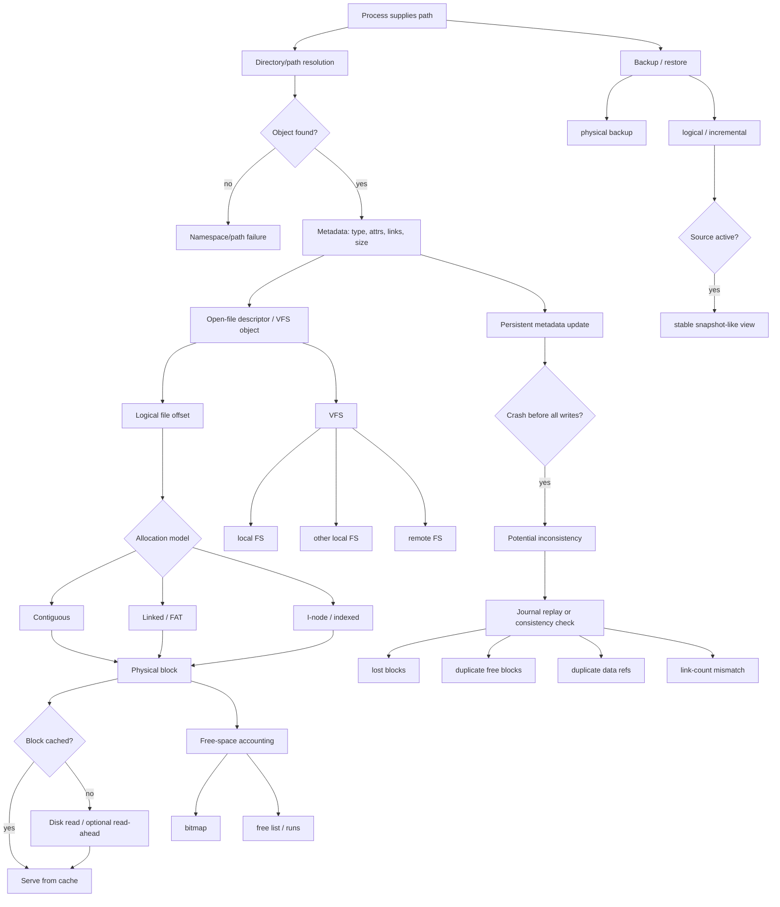

# Chapter 4 conceptual / diagnostic flow



## Operational distinction

```text
path resolution
    ≠ allocation mapping
    ≠ free-space accounting
    ≠ crash consistency
    ≠ durability of dirty cache
    ≠ backup/restore
    ≠ layout/performance optimization
```
