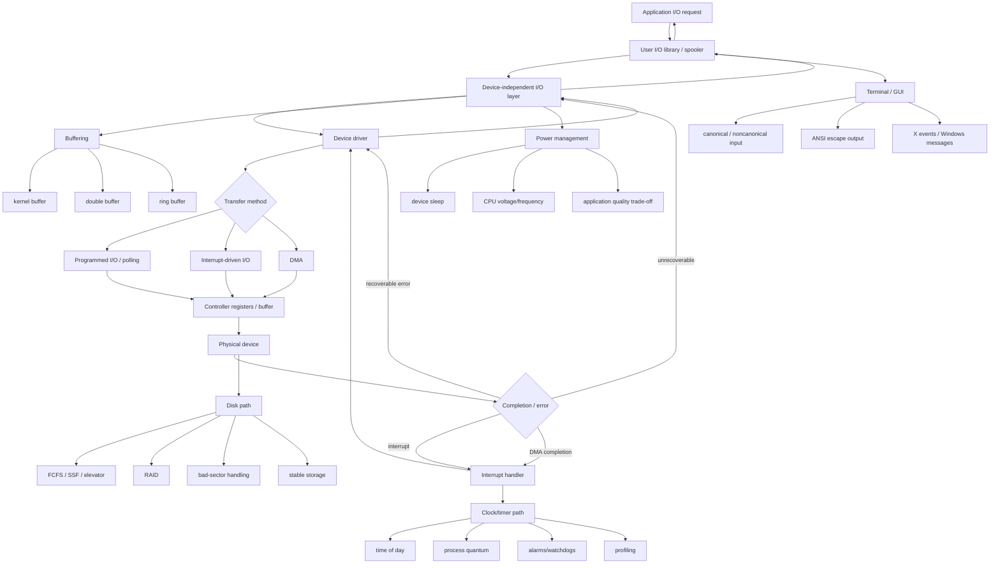

# Chapter 5 conceptual / diagnostic flow



## Diagnostic boundary

```text
application semantics
    ≠ buffering/spooling
    ≠ device-independent policy
    ≠ driver logic
    ≠ interrupt/DMA transport
    ≠ controller/bus
    ≠ physical device/media
```
