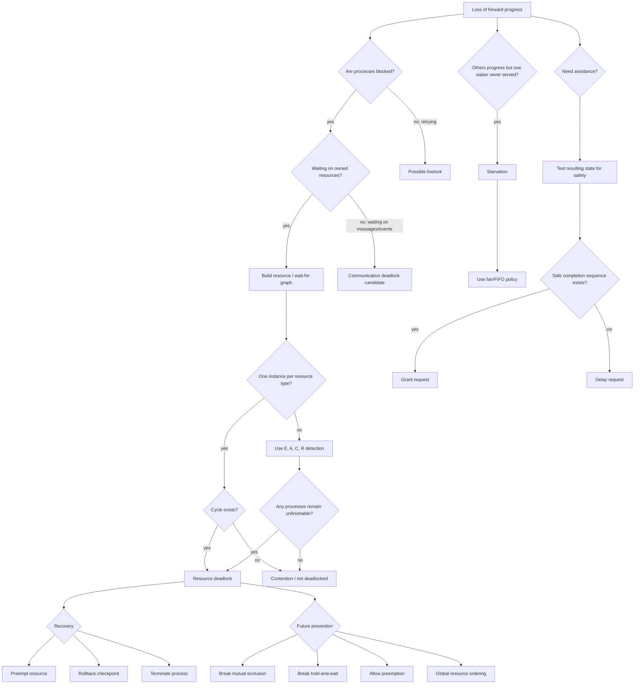

# Chapter 6 conceptual / diagnostic flow



## Classification boundary

```text
contention: progress is delayed
deadlock: blocked dependency set cannot progress
livelock: active retries, no useful progress
starvation: system progresses, one participant may wait forever
unsafe state: no guaranteed completion sequence, but not necessarily deadlocked
```
