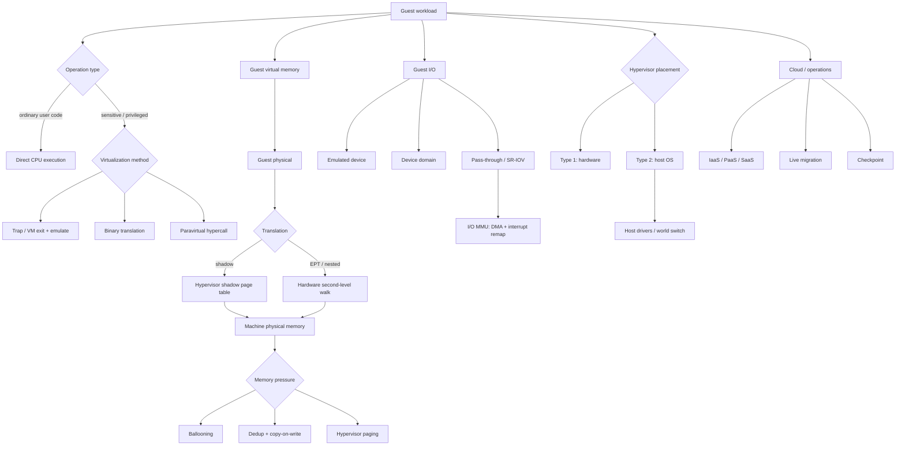

# Chapter 7 conceptual / diagnostic flow



## Diagnostic boundary

```text
guest app
  ≠ guest kernel
  ≠ virtual CPU/MMU/device
  ≠ hypervisor/VMM
  ≠ host OS or device domain
  ≠ physical CPU/MMU/IOMMU/device
```
