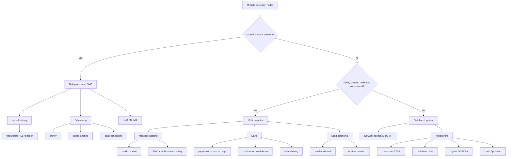

# Chapter 8 conceptual / diagnostic flow



## Diagnostic boundary

```text
shared-memory contention
  ≠ message-copy/RPC overhead
  ≠ DSM coherence/page movement
  ≠ distributed-network latency
  ≠ middleware semantics
```
