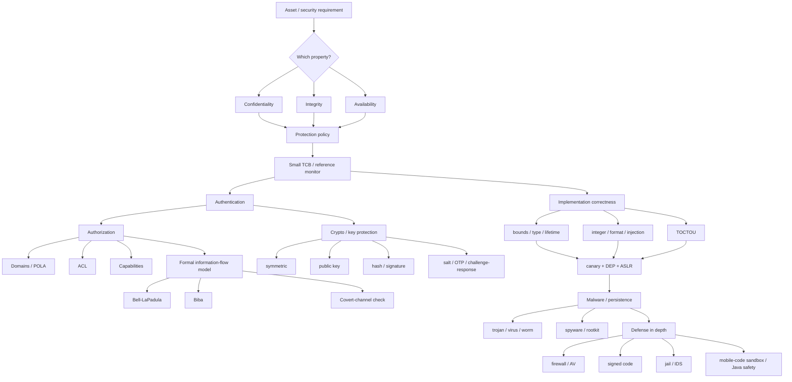

# Chapter 9 conceptual / diagnostic flow



## Diagnostic boundary

```text
authentication ≠ authorization
encryption ≠ integrity
formal policy ≠ bug-free implementation
malware deletion ≠ restored trust
one defense layer ≠ defense in depth
```
