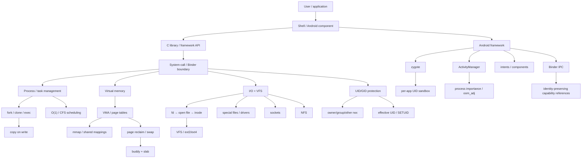

# Chapter 10 conceptual / diagnostic flow



## Diagnostic boundary

```text
process identity ≠ address-space sharing
file descriptor ≠ inode
pathname permission ≠ already-open access
page fault ≠ necessarily invalid memory
Android application state ≠ Linux process lifetime
Binder object identity ≠ proof of original recipient process
```
