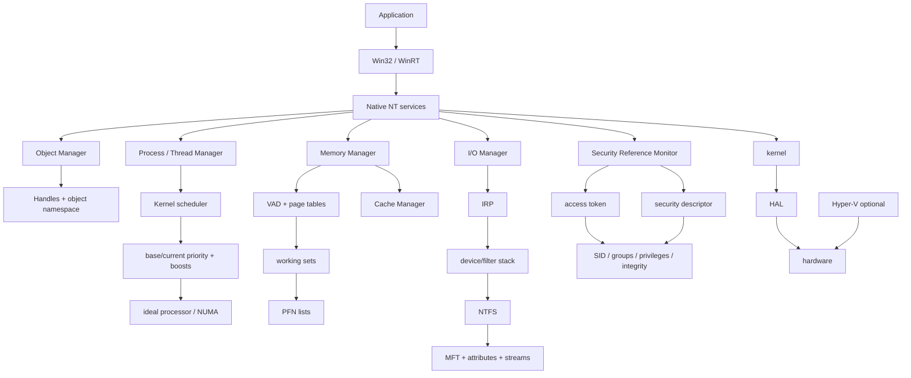

# Chapter 11 conceptual / diagnostic flow



## Diagnostic boundary

```text
process ≠ scheduled entity
handle ≠ pointer
reserve ≠ commit
soft fault ≠ storage I/O
file ≠ one byte stream
DACL allow ≠ integrity-level allow
hibernate ≠ shutdown
```
