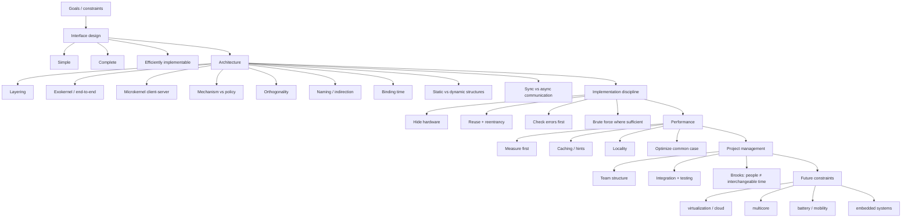

# Chapter 12 conceptual / diagnostic flow



## Diagnostic boundary

```text
minimal ≠ incomplete
mechanism ≠ policy
cache ≠ hint
reuse ≠ reentrancy
more optimization ≠ better system
more developers ≠ proportionally shorter schedule
```
