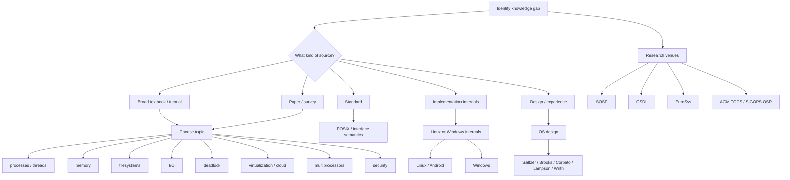

# Chapter 13 conceptual / reading flow



## Boundary

```text
bibliographic recommendation ≠ proof of current edition
source-era venue cadence ≠ current schedule
publisher-linked bibliography ≠ content present in local PDF
chapter 13 ≠ conventional review-question chapter
```
