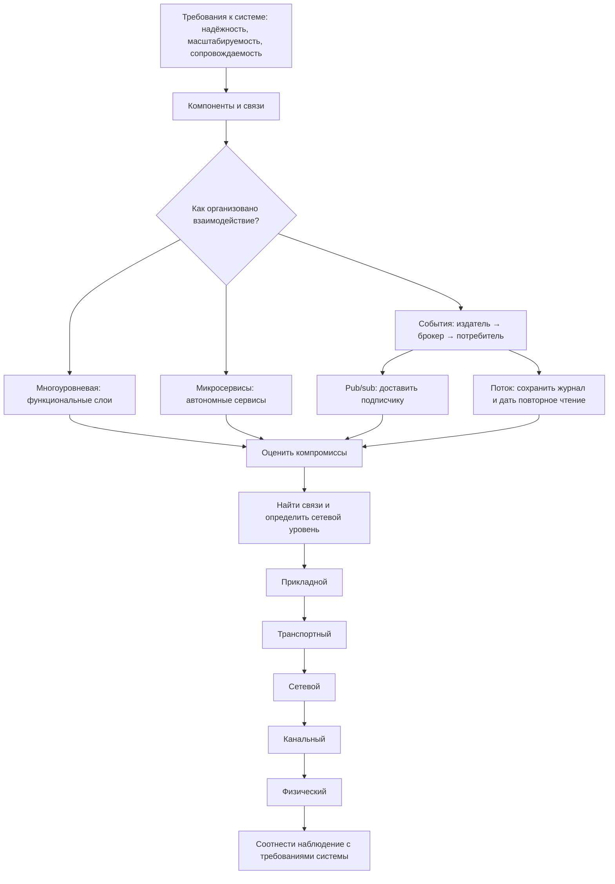

# Глава 1 — логика систем и связей

Схема ниже составлена из архитектурных примеров и пятиуровневой модели главы (PDF 28–36), а не воспроизведена из иллюстрации PDF.

## Как интерпретировать

- Система — это не сумма независимых деталей: выбор шаблона определяет связи и компромиссы (PDF 28–31).
- Событийный шаблон имеет разные модели судьбы событий — доставка/удаление и сохранение/воспроизведение (PDF 30–31).
- Пять уровней разделяют предмет анализа; сама глава предупреждает, что фактические границы могут перекрываться (PDF 32).
- Последовательность уровней — концептуальная карта, не конкретный сетевой trace или автоматизированная диагностическая процедура.

**Provenance:** `p0028:c01`–`p0036:c01`. Замечания к классификации протоколов — `source-findings.md`.
