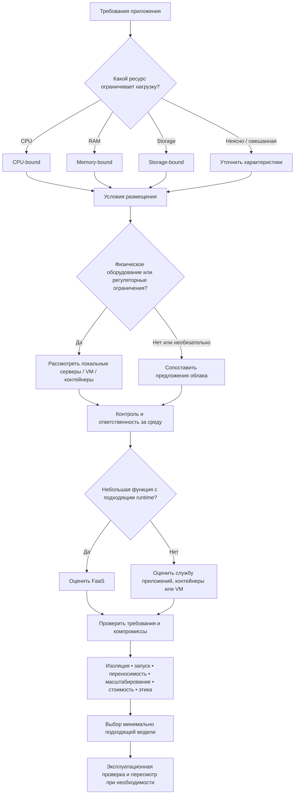

# Диаграмма выбора вычислительной среды

Основание: RAG PDF 37–47, включая классификацию нагрузок (37–38), размещение (38–40), модели исполнения (40–44) и критерии выбора (44–47). Диаграмма показывает **концептуальный порядок анализа**; это не автоматическая процедура изменения системы.

### Обоснование ветвей

- Класс ресурса — это описание рабочей нагрузки, **не** автоматическое указание на технологию исполнения. [37–38]
- Локальная среда сохраняет контроль над аппаратурой, но увеличивает задачи по управлению; облачные сервисы дают разные уровни абстракции. [39–40]
- FaaS подходит для малых функций, но нужно учитывать среду выполнения и возможную привязку к платформе; приложения крупнее могут использовать managed app/runtime, контейнер или VM. [41–45]
- Контейнеры и VM имеют разные границы изоляции и требования к операционной системе; критерии не следует сводить к «быстрее = лучше». [45–46]
- Проверка конкретных числовых порогов, команд, бюджета и отката: **[Needs confirmation]** — они не даны в главе.

Диаграмма не изменяет никакие ресурсы.
