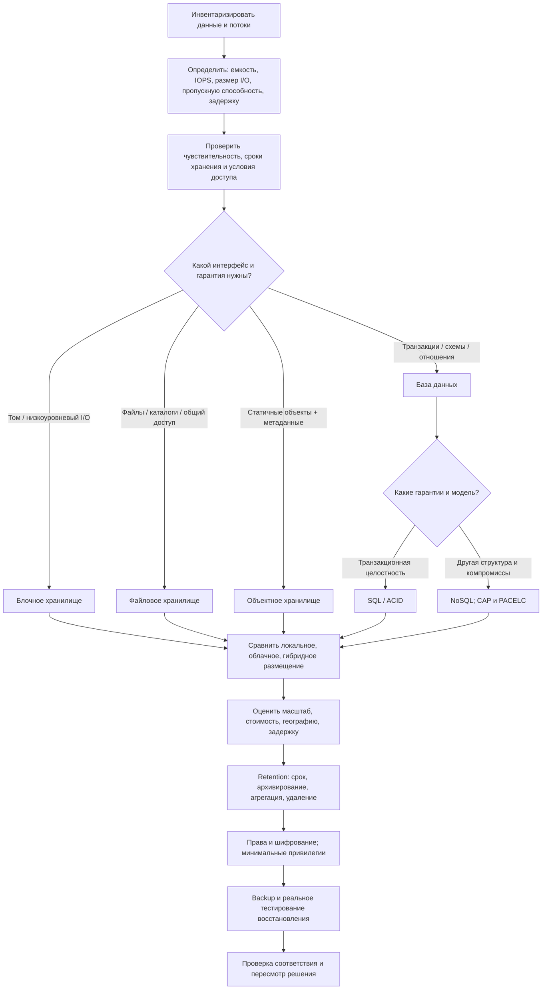

# Диаграмма выбора системы хранения — глава 3

**Основание:** RAG PDF 48–62. Это концептуальная карта решений автора, а не автоматизированная диагностика или команда развертывания.

## Доказательство последовательности

- A–C: список вопросов об источнике, потреблении и правовом/эксплуатационном контексте данных. [PDF 48–50, 56–57]
- D–K: четыре типа хранилищ, ACID и компромиссы распределенных БД. [PDF 52–56]
- L–M: локальная/облачная/гибридная модель, стоимость и масштабирование, репликация. [PDF 56–58]
- N–O: жизненный цикл хранения, конфиденциальность, принцип наименьших привилегий, шифрование. [PDF 59–61]
- P–Q: моделирование потери данных и документированное восстановление; проверка целесообразности выбранного решения. [PDF 61–62]

**Граница:** диаграмма не определяет конкретный продукт, сроки retention, допустимые задержки, RPO/RTO, команды, бюджет и rollback. Эти значения — **[Needs confirmation]**.
