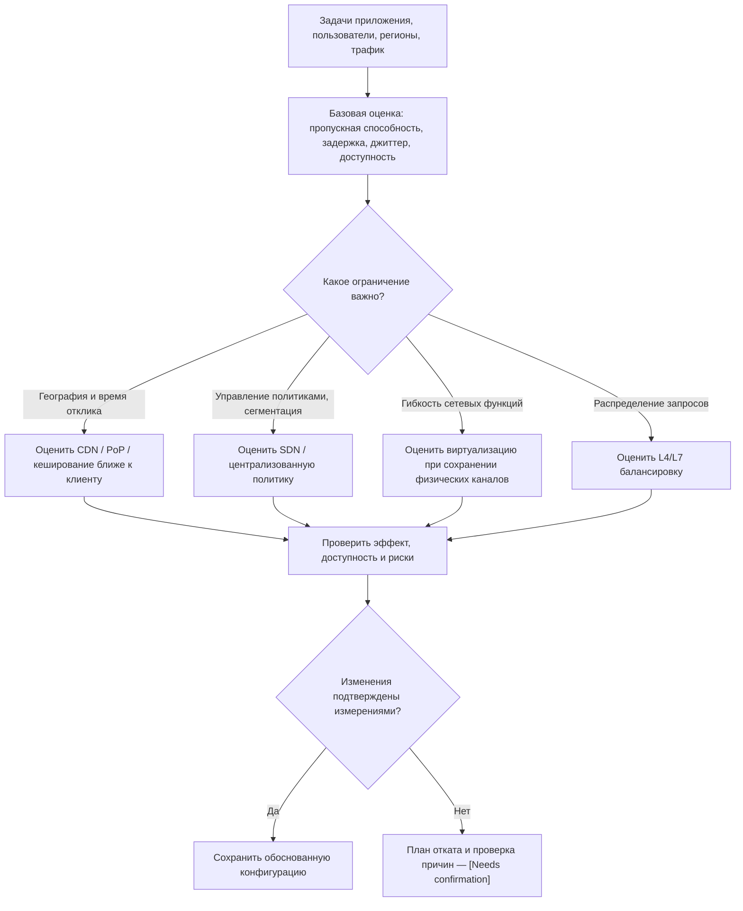
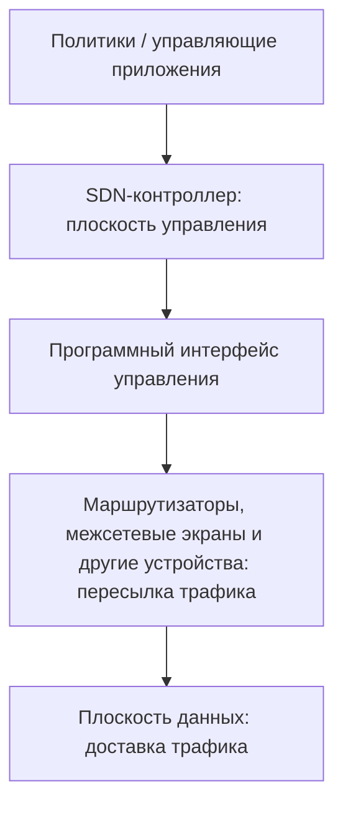

# Сетевая логика главы 4

**Provenance:** книга 0011, RAG `p0063:c01`–`p0071:c01`, PDF 63–71. Структурная схема по содержанию главы, не модель конкретной инфраструктуры.

## Путь пользовательского запроса

Маршрут отражает учебный пример PDF 63; детали фактической инфраструктуры и расположение каждого компонента зависят от среды.

## Стратегия сети и контроль рисков

Вторая схема — **синтез по логике главы**, не дословный алгоритм автора; конкретная процедура диагностики, пределы метрик, доступы и rollback в исходном тексте отсутствуют.

## SDN — разделение ответственности

См. PDF 67–68; направление названий API `northbound`/`southbound` в извлечённом русском тексте отдельно отмечено в `source-findings.md`, не подменено внешними схемами. Все три диаграммы используют только концепции, которые обсуждаются в RAG.
