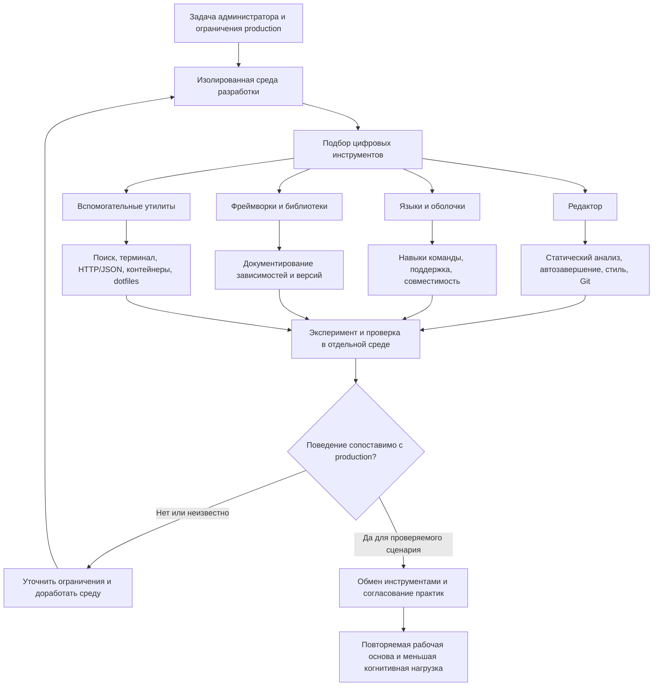

# Схема главы 5 — цифровой инструментарий

**Происхождение:** RAG PDF 73–82, `p0073-c01` — `p0082-c01`. Схема концептуальная, отражает организацию главы; это не утверждённый промышленный runbook.

Граница применимости: виртуальная среда может не воспроизвести аппаратные неисправности (пример ленточной библиотеки в PDF 74). Точные условия перевода изменения в production, командные процедуры и rollback — **[Needs confirmation]**.

Чтение RAG: PDF 73–74 — необходимость изоляции; PDF 75–76 — редактор; PDF 77–79 — языки и зависимости; PDF 79–81 — утилиты и dotfiles; PDF 82 — вывод автора.
