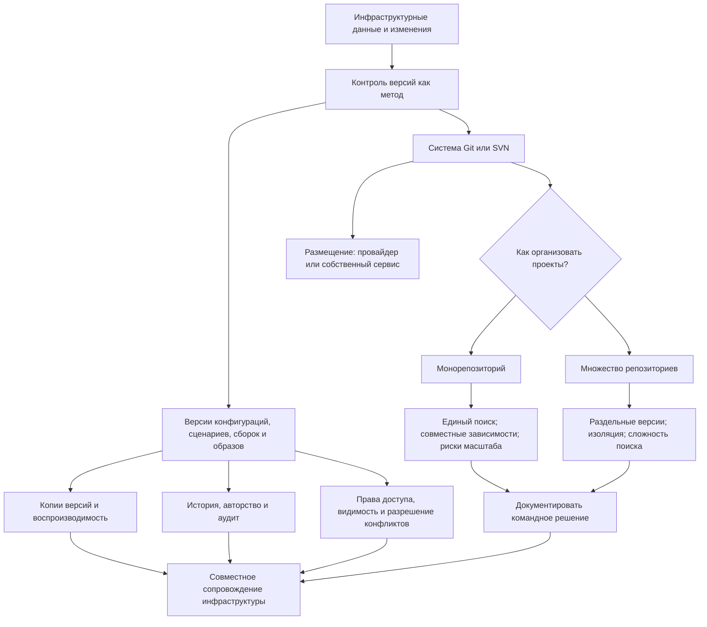

# Логика главы 6 — контроль версий инфраструктуры

**RAG provenance:** PDF 83–88, chunks `p0083-c01` — `p0088-c01`. Это концептуальная схема, а не инструкция запуска неупомянутых команд.

Границы: конкретные рабочие команды настройки репозитория, разграничения прав, отката и восстановления в этой главе отсутствуют: **[Needs confirmation]**. Различие Git и SVN, провайдеров, практики и артефактных хранилищ см. PDF 84; критерии mono/multi см. PDF 86–87; итоговые преимущества см. PDF 88.
