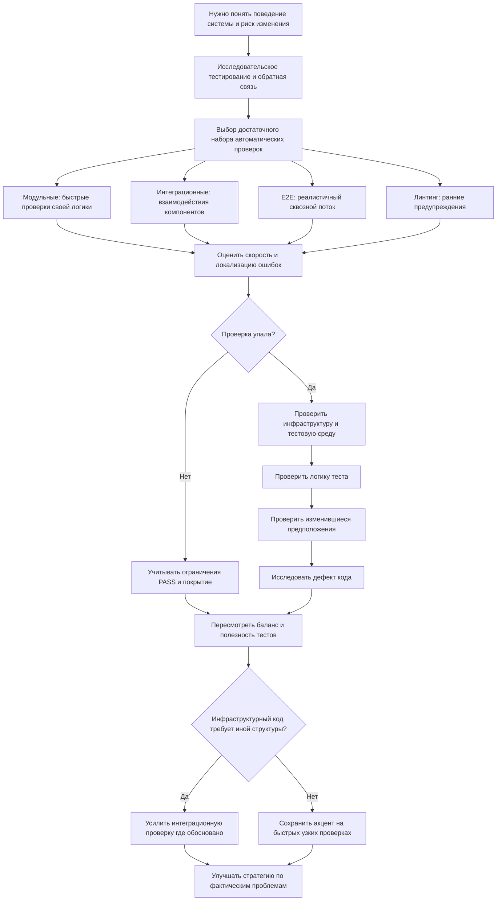

# Концептуальная схема главы 7: тестирование инфраструктуры

**Основание:** canonical RAG PDF 89–99 (`p0089:c01` — `p0099:c01`). Представлена логика авторского объяснения, **не буквальное воспроизведение рис. 7.1–7.6**, которые в текстовом RAG извлечены неполно.

Не следует считать ветви анализа причин отказа доказательством последовательного исключения дефектов: это группы возможных причин из PDF 97–98. Изображение схемы тестов из оригинального PDF напрямую не анализировалось. Точные эксплуатационные команды, thresholds и rollback: **[Needs confirmation]**.
