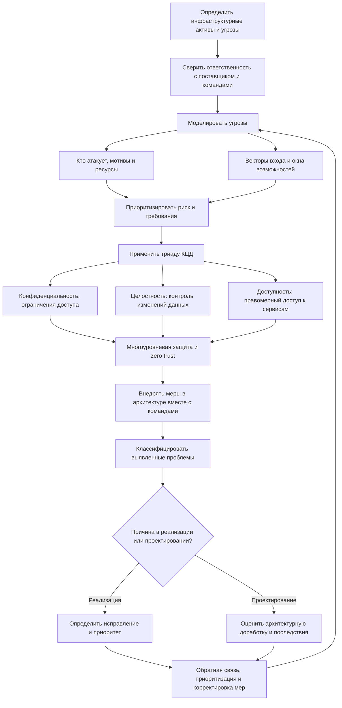

# Схема главы 8 — модель работы с рисками

**Источник:** RAG PDF 100–108. Концептуальная схема по тексту, не точная реконструкция рис. 8.1.

**Ограничения:** конкретные команды, политики сети/IAM, абсолютные пороги оценки и rollback не приведены (RAG_MISS / [Needs confirmation]). В книге подчёркнуто, что даже при IaaS/PaaS/FaaS остаются обязанности клиента, а модель КЦД помогает обсуждать требования безопасности (PDF 101–102, 106).
