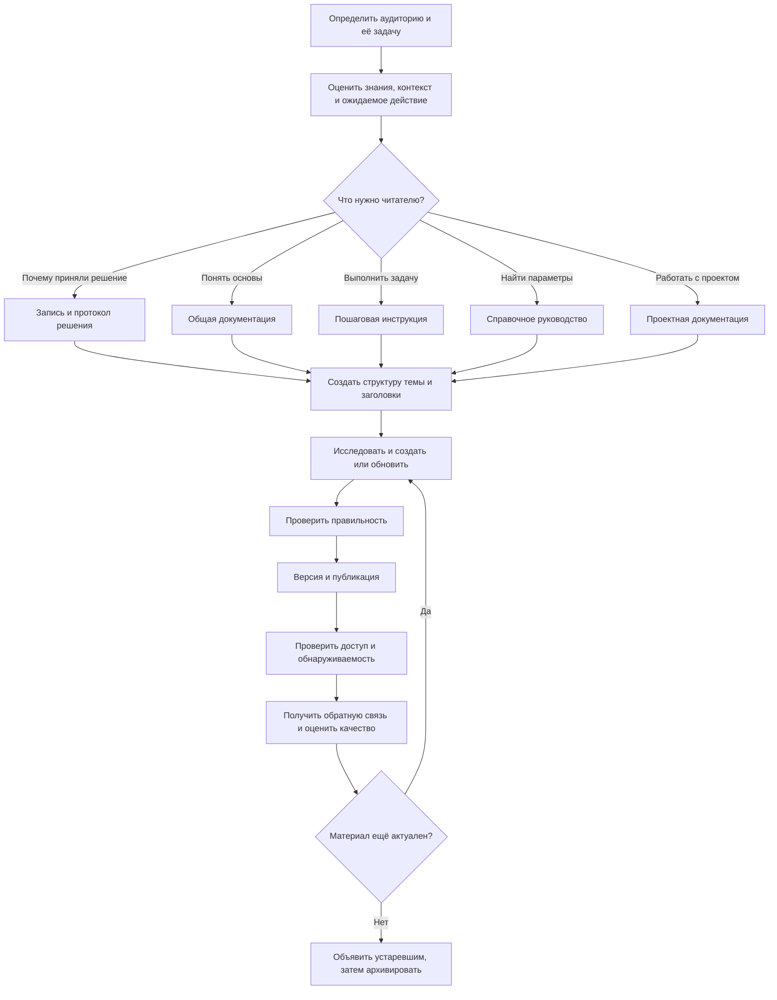

# Логика главы 9 — документация как часть системы

**Provenance:** canonical RAG PDF 109–115. Это концептуальная Mermaid-схема по тексту, не реконструкция оригинальных рисунков 9.1–9.3.

Критерии на протяжении цикла: точность, наличие, доступность, упорядоченность, сопровождаемость (PDF 114–115). Для аварийных материалов проверить возможность доступа при недоступности сети и электропитания (PDF 114). Численные SLA, исполняемые команды и rollback — **[Needs confirmation]**.
