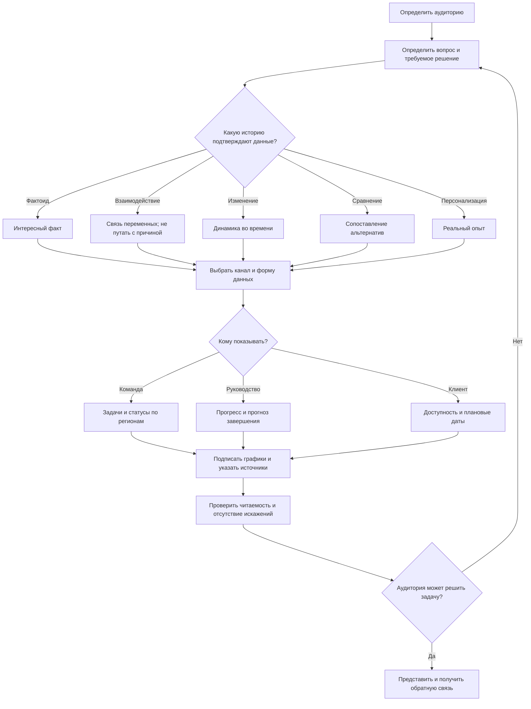

# Mermaid — от аудитории к решению

Источник: canonical RAG PDF 116–133. Это авторская **концептуальная** схема по тексту, не точная реконструкция рис. 10.1–10.8.

Обоснование типов историй: PDF 120–121; три панели: PDF 124–127; качество графики и критерий успешной коммуникации: PDF 127–133. Команд для реализации схемы и универсального rollback источник не даёт — **[Needs confirmation]**.
