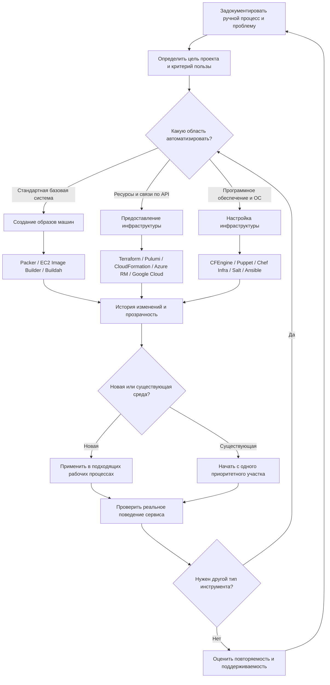

# Схема главы 11: выбор направления инфракода

**Источник:** canonical RAG PDF 135–144. Концептуальное обобщение текста, не копия рис. 11.1–11.4.

**Контрольный пример:** синтаксически корректные DNS-записи не гарантируют доставку почты при отсутствии SPF и DKIM (PDF 141). Конкретных CLI, численных порогов приемки и rollback источник не приводит — **[Needs confirmation]**.
