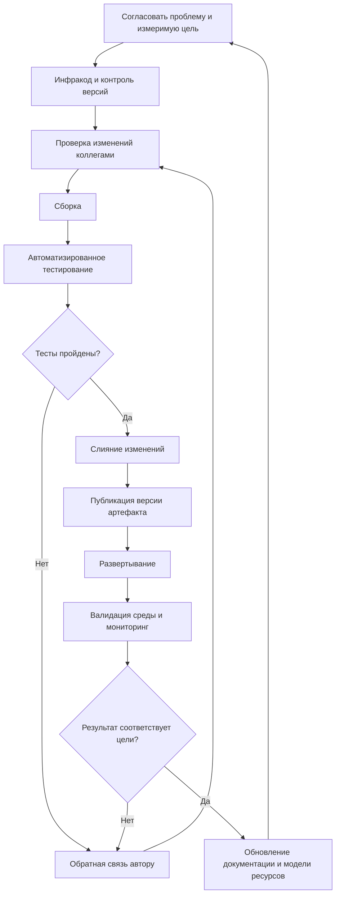

# Схема главы 12: жизненный цикл управления инфраструктурой

Источник: canonical RAG PDF 145–156. Это концептуальная схема по тексту, **не** реконструкция оригинальных рис. 12.1–12.2.

Последовательность «сборка → тест → слияние → выпуск → развёртывание → валидация» основана на PDF 147–148, но автор подчёркивает, что этапы реального конвейера должны соответствовать процессам конкретного проекта. Модели IaD/GitOps требуют учитывать данные, метаданные, историю и утверждённое состояние (PDF 150). Реальный rollback: **[Needs confirmation]**.
