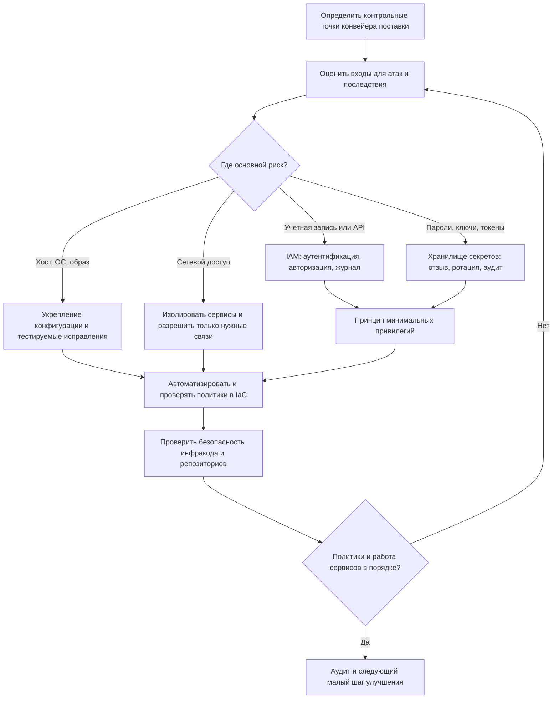

# Концептуальная схема главы 13: защита по этапам

**Источник:** canonical RAG PDF 157–171. Это новая Mermaid-схема по тексту; **не** точное воспроизведение повреждённого рис. 13.1.

При оценке поставки в PDF 158 названы VCS, среда сборки, платформа сборки, реестры образов, рабочие ресурсы и данные. Проверка IAM, защита секретов, укрепление ОС и zero trust — PDF 159–169; рекомендации, Checkov и Gitleaks — PDF 169–170. Реальная процедура rollback — **[Needs confirmation]**.
