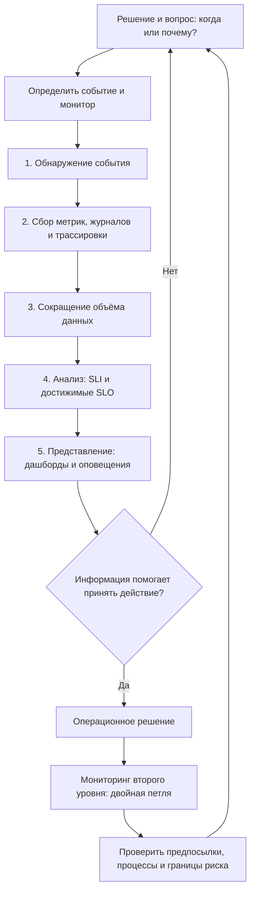

# Концептуальная схема главы 14: два уровня мониторинга

**Источник:** `rag_only`, PDF 173–181. Новая схема на основании текста, **не** графическая реконструкция оригинального рисунка 14.1 (PDF 177).

Пять последовательных шагов — PDF 177–180. Обратная связь первого уровня и двойная петля обучения — PDF 180–181. Выбор SLI/SLO и визуализации зависит от конкретной среды; пороги, универсальные команды и rollback **[Needs confirmation]**.
