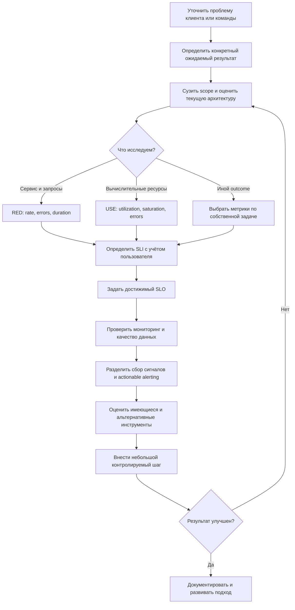

# Схема главы 15 — от желаемого результата к устойчивому мониторингу

**Источник:** RAG PDF 182–194. Это новая Mermaid-модель по тексту, **не** точное воспроизведение рис. 15.1 (PDF 182–183).

RED и USE — PDF 185–186; архитектура, перекрытие мониторов и пример очередей — 186–188; SLI, alerts и SLO — 189–190; выбор инструментов — 190–193; адаптация и заключение — 194. Конкретный test plan, production-порог и откат — **[Needs confirmation]**.
