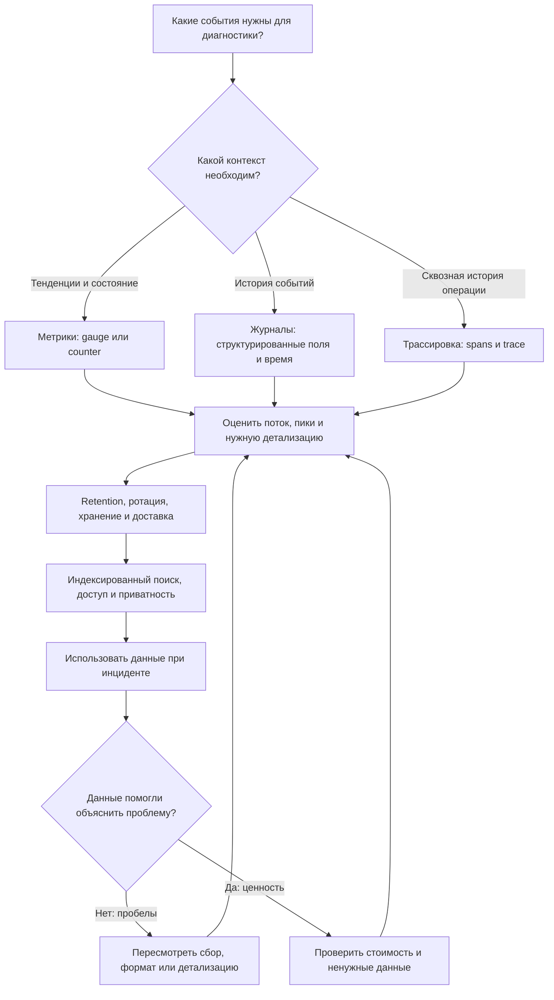

# Mermaid — логика управления данными мониторинга (глава 16)

**Provenance:** RAG PDF 195–202; концептуальная схема по тексту, не копия рисунка.

Основание ветвей: метрики — PDF 196; журналы/структура/время — 197–198; трассировка и OpenTelemetry — 198–199; компромиссы и доставка — 199; ротация и поиск — 200; feedback, стоимость и контроль доступа — 201–202. Реальные значения лимитов и rollback **[Needs confirmation]**.
