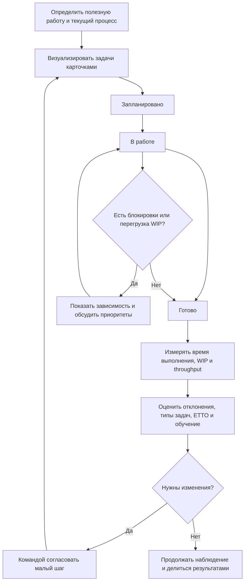

# Схема главы 17 — визуализировать работу и улучшать поток

**Источник:** RAG PDF 203–211. Это новая концептуальная Mermaid-схема по тексту, **не** реконструкция оригинального рисунка 17.1.

Принципы канбан — PDF 205, доска и карточки — 206–207, метрики — 207–210, заключение и зависимости — 211. На схеме нет численного WIP-лимита, которого автор не задаёт. Обсуждение приоритетов и изменение процесса должно учитывать участие команды.
